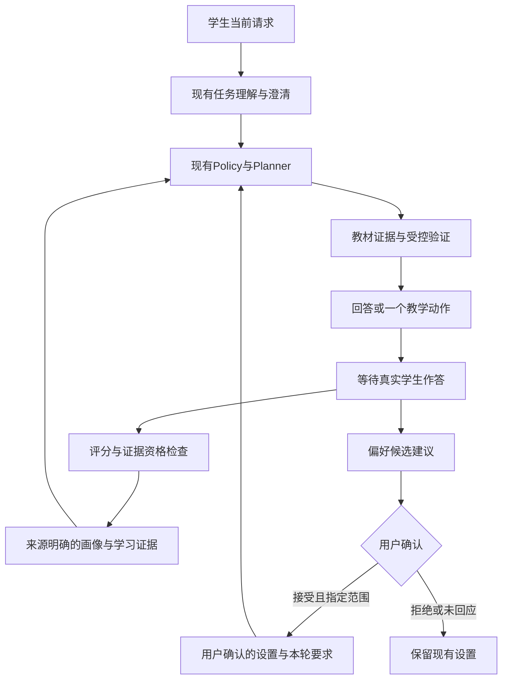

# 08 协作架构与关系传递性例子

读取：ziliao.md 785–848、415–425（A360–423、B415–425）。过滤Mermaid CSS后保留图中实际标签。2026-10-12。

## 保留什么、补什么

资料“只增加教学决策执行层”不符合今天工作区：已有TeachingPolicy、TeachingPlanner、QuestionDesigner、TaskExecution及任务澄清。沿用TeachingPlan，在需要时补diagnosis/evidence_refs、learner_constraints、evaluation_target，而非另建同名Engine。明确短任务与教学会话状态分工。

AI不生成假学生回复接着自教多轮；用户未回应不视为同意。画像客观证据更新与偏好授权更新分别记录。

## 例子应如何落地

学生：“我觉得这个关系满足传递性，但我不会证明。”

1. 如果缺关系定义/集合，先补必要信息；不能直接判断误区或不会定义。
2. 有限关系可用确定性枚举找(a,b)、(b,c)存在且(a,c)缺失的反例；输入须明确集合与关系。空关系、没有可链接二元对等边界需覆盖。
3. 若学生只想看证明，给必要的完整推理；若选择引导，先问一个具体起点，再根据其真实回答决定提示等级。
4. 对无限关系或一般定理，有限枚举通过仅是例子，不能声称已证明。
5. 诊断区分概念混淆、证明组织困难、符号表达困难及证据不足；不要仅凭“不会证明”写永久误区。
6. 新关系独立判断与解释形成下一条证据；看过答案/获得提示的成功保留过程，但不计独立掌握。延迟复测用于确认误区是否消退。

## 研究结论的适用范围

全部方案基于当前离散数学助教；实验心理学要求另外建立课程技能、图文材料和评分准则。小规模真实学生交叉试验应控制顺序与练习迁移、使用不同但等价题，并记录模型/教材/提示版本；不能沿用同一道题前后测就宣称长期掌握提升。
