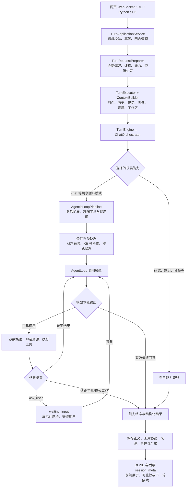

# DeepTutor 完整对话流程与工具能力深度调研

日期：2026-10-19。调研对象：用户指定的 `D:/deeptutor` 本地源码。

## 1. 源码核查后的结论

DeepTutor 的可复用主体是“持久化对话运行时 + 上下文与来源装配 + 多种能力入口 + Agent 循环 + 工具执行 + 交互事件 + 学习状态服务”。教材 RAG 和模型网关只是其中两部分。若目标是整体采用它的对话体验，接入范围需要覆盖这一整套运行机制。

它的普通聊天流程并非固定的“意图识别 Agent → 教学规划 Agent → 回答 Agent → 质检 Agent”。真实实现是：先根据请求、会话、课程及工作区确定能力和资源，按条件进行材料预读和知识库预检索，然后让模型在一个循环里选择工具、追问或回答。不同模式可替换提示协议、增加工具和完成门槛。

需要纠正此前讨论中的五处假设：

1. **不存在普通聊天每轮必经的独立意图分类 Agent。** 用户/会话选择及上下文是主要入口；自动能力路由中核实到的是可选的明确出题请求规则。
2. **不存在普通聊天每轮必经的独立答案质检 Agent。** 普通循环通常以没有工具调用的模型回复完成；Mastery、解题、可视化等模式有各自的确定性状态或载荷门槛。
3. **`exploring/responding` 等阶段说明不等于固定执行两次模型。** 当前普通聊天的核心是单循环，工具轮的说明文字也可以实时显示。
4. **工具并非全部同时可用。** 核实有 100 个内置工具描述符、11 个顶层回合能力、14 个循环扩展。它们经过上下文、权限、配置和模式筛选。
5. **持久化恢复不等于进程死亡后恢复 Python 协程。** 事件、消息和模型协议可保存；已经丢失执行租约的回合会被回收，不能据“断线恢复”推断任意暂停点都能无缝重启。

依据：[请求准备](D:/deeptutor/deeptutor/services/session/turns/request_preparer.py:138)、[能力路由](D:/deeptutor/deeptutor/runtime/capability_routing.py:56)、[聊天循环](D:/deeptutor/deeptutor/agents/loop/agent_loop.py:403)、[工具挂载](D:/deeptutor/deeptutor/agents/_shared/tool_composition.py:174)。

## 2. 调研方法与可信范围

- 本地 Git 提交：`6cf793bd868ba5ecbe64722936d4be8fab5a01df`。工作区有一处已有修改：`deeptutor/services/llm/factory.py`；本轮没有修改它。
- 对 99 个相关 Python 文件建立 AST 符号、行号和 SHA-256 清单；人工追踪主要入口、回合、上下文、循环、工具、教材检索、学习反馈等调用路径。99 个文件不表示逐个函数均已执行。
- 静态展开并核对全部 100 个工具描述符与真实类定义，包括 `view_figure` 的重导出；核对 11 个顶层能力和 14 个循环扩展的入口、激活条件及钩子。
- 另外阅读 WebSocket 客户端、聊天状态适配器和输出组件，核对前后端协议关系。
- 在隔离运行目录执行 6 个相关测试模块：**224 项通过，1 项失败**。测试使用替身模型/存储，未调用真实模型、解析正式教材或操作学生数据库。
- 读取宿主 `.venv-deeptutor` 的包版本元数据，区分“源码实现存在”和“该环境依赖已经安装”。没有读取 D 盘真实凭据和业务数据。

完整清单：[TOOLS_CAPABILITIES.md](TOOLS_CAPABILITIES.md)。可复核证据：[SOURCE_AUDIT.json](SOURCE_AUDIT.json)、[DEPENDENCY_SNAPSHOT.json](DEPENDENCY_SNAPSHOT.json)、[VALIDATION.md](VALIDATION.md)。

## 3. 一次普通对话的实际调用链

| 顺序 | 实际执行内容 | 源码位置 |
| --- | --- | --- |
| 1 | WebSocket 鉴权、命令解析、启动/订阅/取消/回复；CLI 与 SDK 也接同一应用层 | [unified_ws.py](D:/deeptutor/deeptutor/api/routers/unified_ws.py:44)、[facade.py](D:/deeptutor/deeptutor/app/facade.py:65) |
| 2 | `client_submission_id` 及请求摘要支持重复提交复用；检查活跃回合冲突及失主回收 | [TurnApplicationService](D:/deeptutor/deeptutor/app/service.py:37) |
| 3 | 合并会话偏好、课程默认项、语言、请求配置、能力和资料；执行学习访问限制 | [TurnRequestPreparer](D:/deeptutor/deeptutor/services/session/turns/request_preparer.py:138) |
| 4 | 解析附件、当前来源及上下文；准备用户回复队列、模型选择和工作区 | [TurnExecutor](D:/deeptutor/deeptutor/services/session/turns/executor.py:139) |
| 5 | 建立展示历史与模型历史；按预算压缩，保留模型工具协议 | [ContextBuilder.build](D:/deeptutor/deeptutor/services/session/context_builder.py:507) |
| 6 | `TurnEngine` 将 `UnifiedContext` 交给 `ChatOrchestrator`；按 active_capability 分发，缺省为 chat | [TurnEngine](D:/deeptutor/deeptutor/runtime/turn_engine.py:17)、[ChatOrchestrator](D:/deeptutor/deeptutor/runtime/orchestrator.py:58) |
| 7 | 为本轮创建能力实例、工具视图和激活扩展，装配 schema、提示词及资源清单 | [AgenticLoopPipeline.run](D:/deeptutor/deeptutor/agents/loop/pipeline.py:397) |
| 8 | 条件性资料调查、知识库预检索、模式状态种子，再进入模型循环 | [AgentLoop.run](D:/deeptutor/deeptutor/agents/loop/agent_loop.py:309) |
| 9 | 模型选择检索、读取/计算、记录、交互或回答；引擎执行工具并把结果写回模型对话 | [AgentLoop._run_loop](D:/deeptutor/deeptutor/agents/loop/agent_loop.py:403) |
| 10 | 收集正文、来源、产物和真实模型协议，保存消息；提交终态后发 DONE | [TurnExecutor 保存路径](D:/deeptutor/deeptutor/services/session/turns/executor.py:1015) |
| 11 | 可能继续生成会话标题等 metadata；客户端按游标重连、重放和协调消息身份 | [subscribe_turn](D:/deeptutor/deeptutor/app/service.py:179)、[TurnRuntimeClient](D:/deeptutor/web/features/chat/transport/TurnRuntimeClient.ts:103) |

## 4. 意图理解、能力选择和澄清

### 4.1 执行前主要处理的是请求和模式，不是全能意图分类

`TurnRequest` 直接携带 content、capability、tools、knowledge_bases、课程、工作区、阅读引用、persona、模型选择等信息。请求准备层结合当前会话偏好和课程默认值，确定本轮的能力及资源。

`ChatOrchestrator` 的职责是选择已经确定的 `active_capability`，没有该值就使用 `chat`。源码中没有发现它先调用 LLM 将所有自然语言请求分类成某套通用教学意图。

已核实的 `route_explicit_quiz_request` 是较窄的规则路由：只有启用 auto_route、原请求为 chat、未处于绑定工作区，且明确要求生成测验题组，才路由到 `deep_question`。模糊提及练习、考试以及互动式“考考我”等，不因此自动改成静态题组生成。自动开关可来自本轮请求或系统设置，代码默认回退为关闭。

### 4.2 进入 chat 后由模型结合上下文决定下一步

模型读取完整提示协议、当前用户消息、历史、资料、资源目录和工具定义，自己决定是否已经足以回答、需要搜索教材、需要追问或执行其他操作。这是语义判断发生的主要位置。

工具选择仍受确定性规则约束：不存在于本轮授权工具视图中的工具不能因为模型想用就执行；上下文和作用域参数由服务端补入。

### 4.3 真正的澄清机制是 ask_user

普通聊天可以在需要时调用 `ask_user`。显式 `ask_questions` 能力通过 `initial_tool_choice="ask_user"` 要求先开始问答卡。

`ask_user` 返回结构化问题后，循环发出 `wait_for_input`，回合切为 `waiting_input`，等待该回合的回复队列。用户答案到来后，流程把实际答案替换到对应 tool 消息中，再继续解决最初请求；不是只在普通文本里问一句就把任务结束。

依据：[AskQuestionsCapability](D:/deeptutor/deeptutor/capabilities/ask_questions/capability.py:36)、[等待与答复装配](D:/deeptutor/deeptutor/agents/loop/pipeline.py:1189)、[状态与回复队列](D:/deeptutor/deeptutor/services/session/turns/executor.py:174)。

## 5. 上下文、记忆和资料如何进入模型

### 5.1 历史不是简单截取最后几条文本

`ContextBuilder` 区分公开的对话展示历史和模型真实历史，后者可以携带 assistant/tool 消息、模型供应商响应状态及本轮协议。压缩时会处理不完整尾部，限制摘要与近期内容预算。

默认历史规划比例为有效上下文窗口的 35%，摘要目标占该历史预算的 40%；另有 token 上限。预算是规划目标，源码明确保留最新非空消息，即便它单独已经很长。循环还会检查总上下文，按需要压缩/裁剪较旧工具结果，附加相应提示。

### 5.2 提示词按职责装配

`LoopPromptAssembler` 组合基础身份与循环协议、课程约定、模式规则、persona、学习者画像、显式记忆、学习日志、来源目录、笔记本、技能、工具及工作区信息。

可变信息被组织成具名 runtime snapshots，只有变化的区块才追加新快照；旧区块消失时显式标记清空，减少历史中旧资源、旧状态继续生效的机会。模型实际工具协议另行保存，便于后续回放。

依据：[提示词装配](D:/deeptutor/deeptutor/agents/loop/prompt_blocks.py:119)、[历史与快照合并](D:/deeptutor/deeptutor/agents/loop/pipeline.py:466)。

### 5.3 explore_context 是独立的资料理解预处理

当 `source_index` 有可读文本来源时，`ExploreContextCapability` 在正式回答循环前运行 `ContextExplorer`：根据当前问题，用只读的 `read_source` 查阅需要的附件、笔记、书章节、题库条目或被引用历史，形成客观的调查摘要。

它试图解决两类问题：模型跳过附加材料，以及读到另一段 AI 对话后混淆说话身份。该摘要作为资料种子进入回答循环，不作为另一份用户指令。普通回答循环显式设置 `has_sources=False`，材料读取工作主要交给这个前置调查面。

该流程由来源存在触发，不是每轮无条件执行；阅读模式还有自己的材料预定位。附加资料预读和知识库 RAG 是不同的数据路径。

依据：[ExploreContext 激活](D:/deeptutor/deeptutor/capabilities/explore_context/capability.py:67)、[调查执行](D:/deeptutor/deeptutor/capabilities/explore_context/explorer.py:140)、[回答面工具筛选](D:/deeptutor/deeptutor/agents/loop/pipeline.py:726)。

### 5.4 记忆和学习日志承担不同职责

三层记忆包括 L1 原始事件、L2 分学习面摘要、L3 跨场景近期信息/画像/范围/偏好。存在读写、快照、来源引用和整理服务，但不能据此宣称每个普通聊天回合都自动重新评估学生能力。

`write_memory` 的当前普通聊天实现主要新增/编辑偏好，先记录 `preference_stated` 事件，再写带出处的偏好文档；不会仅凭工具名称就把任意对话总结成掌握度。L3 是否直接注入本轮还与 memory references 有关。

`learning_status/learning_update` 管理学习任务、上次进展、下次接续和确认的学习收获，是软教学状态；正式 Mastery 的目标和成绩另有权威状态。

依据：[记忆目录结构](D:/deeptutor/deeptutor/services/memory/paths.py:1)、[偏好写入](D:/deeptutor/deeptutor/tools/builtin/__init__.py:1041)、[学习日志工具](D:/deeptutor/deeptutor/tools/learning_journal_tools.py:1)。

## 6. 教材检索完整链路

### 6.1 解析和索引

`KnowledgeBaseManager` 负责知识库登记及绑定；`ParseService` 负责选择解析器、缓存和解析 IR；`RAGService` 根据知识库已绑定的 provider 分发，避免同一知识库随查询任意换引擎。

源码中有 7 类解析适配：text_only、MinerU、Docling、MarkItDown、PyMuPDF4LLM、LiteParse、Tika。引擎是否安装、模型是否下载、服务是否可用，需要分别检查；不是所有格式都由同一解析器处理。

默认 provider 是 `llamaindex`。其摄取使用上游 `IngestionPipeline`、`SentenceSplitter` 和配置的 embedding 服务；图片可产生带来源的视觉节点。向量存储可使用 FAISS，条件不满足时使用 LlamaIndex 自带存储。索引与 embedding 签名、就绪版本关联。

### 6.2 召回和重排

默认管线支持向量召回、BM25 召回与 `QueryFusionRetriever` 的 RRF 融合；可配置 cross-encoder 重排。重排实现用 SentenceTransformers，并非我们原来的 FastEmbed/ONNX 重排实现。

BM25 依赖缺失可降级为向量检索；重排加载失败也可保留初排结果。对接后必须区分“配置为 hybrid/重排”和“实际上是否运行”，不能仅看开关。

`RAGService.search` 返回教材内容与来源；LlamaIndex 的 `_nodes_to_result` 是把节点整理为片段、来源、page、chunk_id 和 score，最后的教学回答由对话循环生成，不能把它误解成每次检索都额外调用一个固定答案生成 Agent。

依据：[RAGService](D:/deeptutor/deeptutor/services/rag/service.py:127)、[摄取](D:/deeptutor/deeptutor/services/rag/pipelines/llamaindex/ingestion.py:24)、[混合召回](D:/deeptutor/deeptutor/services/rag/pipelines/llamaindex/retrievers.py:150)、[重排](D:/deeptutor/deeptutor/services/rag/pipelines/llamaindex/rerank.py:89)、[来源输出](D:/deeptutor/deeptutor/services/rag/pipelines/llamaindex/pipeline.py:365)。

### 6.3 对话开始前预检索，循环中还能继续检索

普通传统 RAG 知识库在循环前可按当前问题预检索，最多 3 个知识库，每库种子上限 4,000 字符；模型仍可通过 `rag` 补查。PageIndex 和专属知识能力通常通过各自工具阅读，不走相同种子逻辑；某些模式也能主动跳过预检索。

`rag` 不只文本搜索：还支持按确切 source_path、asset_id、图表标号或页面核对原图；视觉像素要经过知识库作用域、资产和源文件状态检查后才送入模型。不支持视觉的模型会收到相应说明。

`SmartRetriever` 另提供多查询和聚合接口，`RAGService` 有封装入口；不能把它当成普通 chat 每轮必经路径。它的摘要输出也不等同于逐字引用与几何定位。

### 6.4 上游来源不自动等于本项目 exact 引用

节点包含的 page/chunk_id/score 只是来源信息；普通节点输出对正文只附较短预览，检索正文另在 content 中。上游检索节点可能重新分块，其 node_id 不是我们现有规范 chunk ID。

原图分支可有 bbox/asset_id 等精细字段，但普通聊天并没有对每条文字结论统一执行我们原来的“原文引句＋PDF 坐标＋教材版本＋语义支持”核验。整体迁入时，这是必须明确保留或适配的课程约束，不能假设打开 RAG 后就已获得相同保证。

## 7. Agent 循环和工具执行规则

### 7.1 循环按模型动作推进

`AgenticChatPipeline` 基本继承通用 `AgenticLoopPipeline`。每轮模型使用同一对话协议：有工具调用就执行并继续；没有工具调用且输出有效、满足模式完成要求时就结束。支持截断续写、推理耗尽处理、模式完成钩子和强制收尾。

默认探索预算 8 轮；另有最多 3 轮必要收尾，再有一次禁用工具的强制回答，因此不能把“8 轮”当成绝对最大模型调用次数。预读、历史压缩和后续标题生成等也会增加模型调用。

普通聊天并非每轮先固定检索、再固定规划、再固定质检。所谓智能行为很大一部分来自提示协议、当前工具和模型决策；确定性部分主要约束资源、执行、状态和特定模式门槛。

### 7.2 挂载规则直接影响产品行为

- 用户开关控制 8 个增强工具，包含源码说明中遗漏的 `zotero_search`。
- 教材、记忆、题库、技能、沙箱和学习主题分别触发条件挂载。
- 普通循环默认还可挂载写偏好、学习日志、网页读取、GitHub、交互和定时任务等工具，可受内置工具白名单约束。
- 工作区 list/read/search/present 是基础面，在独占知识能力和普通内置白名单筛选之外仍会保留。因此 `allowed_builtin_tools=[]` 不能简单解释成整个回合没有任何工具。
- 某些知识能力使用专属工具替换普通工具面，但可为共选的其他知识库保留 RAG。
- 伙伴模式强制挂载专属记忆工具，并抑制普通记忆读写。
- 未配置的媒体生成工具会被进一步过滤。

### 7.3 工具调度有实际执行约束

`dispatch_tool_calls` 每个 assistant 消息最多执行前 15 个工具调用；这不是整回合工具总数上限。批次内相同调用可去重，仍补齐对应 tool 协议消息。

执行顺序分三段：改变本轮目标的 rebinding 工具先串行执行；普通工具可并发；`ask_user/workspace_export` 等暂停工具最后执行并重新绑定状态。服务端注入资源和工作目录等上下文，检查必填参数，对敏感参数和私有执行字段进行展示过滤。

批次去重不能代替跨请求幂等，也不能代替写操作的业务版本检查。原生提交身份、课程状态和题库写入分别承担相应约束。

依据：[工具调度](D:/deeptutor/deeptutor/runtime/agentic/tool_dispatch.py:122)、[工具结果协议](D:/deeptutor/deeptutor/core/tool_protocol.py:126)。

### 7.4 Skill、MCP、CLI 和插件也是对话的一部分

Skill 先以目录进入提示词，模型按需 `read_skill`；工作区、个人、已授权管理员和内置技能有覆盖/授权顺序，always 技能可提前装入。

MCP/CLI 工具经过本轮授权与资源筛选后形成工具视图。通常先给精简目录，模型用 `load_tools` 加载完整 schema，然后在后续轮次直接调用。插件还能贡献工具、顶层能力和循环扩展。

代码运行由统一 `exec` 工具接沙箱，挂载取决于隔离级别和用户授权；并非普通聊天天然拥有本机执行权限。

依据：[Skill 解析顺序](D:/deeptutor/deeptutor/services/skill/runtime.py:26)、[按需工具加载](D:/deeptutor/deeptutor/runtime/registry/deferred_tools.py:1)、[执行工具门禁](D:/deeptutor/deeptutor/agents/loop/pipeline.py:693)。

## 8. 能力与扩展如何改变整段对话

11 个顶层能力及 14 个扩展的逐项入口见完整清单。对本项目最值得注意的差异如下。

| 场景 | 真正采用的流程 | 对接时不能遗漏的部分 |
| --- | --- | --- |
| 普通问答 | 共享 Agent 循环，按需工具与回答 | 提示装配、资料种子、工具执行、事件与历史 |
| 主动澄清 | `ask_questions` 让第一轮选择 ask_user，之后继续原任务 | 问题卡、暂停、答复关联及继续执行 |
| 分步解题 | chat 循环＋solve 计划/完成步骤/重规划状态 | 引擎计划状态与重规划预算 |
| 引导学习 | `MasteryLoopPipeline` 更换基础教学协议，受目标、题卡和模式门槛控制 | 学习/测试/复习模式、真实作答、评分、状态工具和交互卡 |
| 沉浸式阅读 | chat 循环＋材料目录、读取、原图、跳转、批注与视口 | 材料 ID/revision、阅读标签页、原图与跳转反馈 |
| 课程学习入口 | `course_study` 感知课程进展并提出下一步交接 | 课程绑定及实际学习面的导航交接；它本身不是全部教学过程 |
| 静态出题 | `deep_question` 生成题组并支持题目追问 | 结构化题目与作答 UI；不能当成交互式澄清模式 |
| 深度研究 | 专用 ResearchPipeline：澄清/改写、分解、分块研究、迭代写报告 | 大纲确认、队列、资料工具和报告产物 |
| 可视化 | 原生循环提交结构载荷，或分流到 Manim | 载荷校验、画布/Viewer、渲染服务与产物 |
| 音频导读 | 检索→讲稿→语音→发布 | TTS、双声线、可播放文件和转录文本 |

这些流程需要真实状态和前端交互支持。只把最后一段字符串放进我们的聊天框，会丢失问题卡、学习题卡、来源、视口导航、交接、产物和恢复语义。

## 9. 输出、反馈、保存与下一轮接续

### 9.1 输出是事件协议，不只是文本

统一事件包括 stage_start/end、thinking、observation、content、tool_call/result、progress、sources、result、error、session、session_meta、done 和 wait_for_input。前端客户端还处理命令确认、游标、缺口缓冲、断线重连和回合协调。

普通循环在工具调用前写出的说明可属于展示正文；模式可以缓冲、丢弃或替换某轮可见输出。思考轨迹、工具进展、正式文字和结构化卡片因此必须按语义渲染。

主流输出路径没有额外的全局答案复核 Agent。若产品要求“所有教材回答先通过引用/质量检查才显示为正式答案”，需要利用缓冲与发布边界接入这项课程规则，不能把上游默认实时流行为当成现成的预发布核验。

依据：[事件枚举](D:/deeptutor/deeptutor/core/stream.py:19)、[输出策略](D:/deeptutor/deeptutor/agents/loop/agent_loop.py:694)、[前端聊天状态](D:/deeptutor/web/features/chat/ChatStateAdapter.tsx)。

### 9.2 对话反馈、学习日志、评分是不同层

用户下一句追问或纠正作为下一轮输入，也可在 ask_user 暂停中作为结构化回答进入同一个回合。工具执行会反馈结果、失败和状态。学习日志保存跨会话任务接续。

Mastery/题库/练习等才有明确的题目、attempt、结果、提示使用和掌握门槛；统一 `AssessmentRecord` 包含 source、origin、turn_id、question_id、hints_used 等字段，防止把不同来源混成无依据的统一分数。

源码有定量与定性学习目标的不同掌握规则。不能把普通聊天里一句“我懂了”、一条 learning_update 或单个正确选择题，直接解释成所有目标已经掌握。

未发现普通 chat 主链固定执行“情绪/掌握度/置信度三个分析 Agent → 每轮更新画像 → 重新规划教学”的链路；这是此前将我们自己的结构投射到上游时容易产生的误解。

依据：[统一测评数据](D:/deeptutor/deeptutor/learning/assessment.py:64)、[掌握门槛](D:/deeptutor/deeptutor/learning/mastery.py:1)、[Mastery 完成约束](D:/deeptutor/deeptutor/capabilities/mastery/loop.py:304)。

### 9.3 保存与恢复要接完整生命周期

运行时保存正文、来源事件、工具调用、卡片位置、产物附件、真实模型协议及供应商状态。回合状态和事件前缀提交后才发布 DONE，随后可能还有 session_meta 标题事件。DONE 因此不是所有后续元数据都已结束的标志。

WebSocket 断开主要停止该订阅，取消执行是显式命令；只断开本机界面不应被当成模型一定停止。取消会处理执行任务、回复队列和终态，重复提交走提交身份与活跃回合约束。

上游通过租约识别活执行与僵尸回合，不以等待时间判断用户是否还会回答。进程丢失后可重放已保存事件、回收失主回合并重试；不能宣称已经恢复丢失的内存回复队列或任意工具操作。

### 9.4 错误处理有兼容策略，需要产品明确接受

循环支持传输重试、输出截断续写、推理预算耗尽处理和工具失败后的有限收尾。有些兼容路径会在模型拒绝工具 schema 时去掉工具重试，或在图像不支持且策略允许时去掉图像重试，并发出提示。

这能改善通用聊天可用性，但对于“必须核对教材原图”“必须完成实际检索”的任务，是否允许该降级需要我们通过模式/模型能力和发布规则明确控制。不能把文本降级后的正常结束当作原图核验成功。

## 10. 核查到的环境缺口

宿主现有 `.venv-deeptutor` 的发行包元数据如下，完整版本见依赖快照。

| 项目 | 当前检查结果 | 含义 |
| --- | --- | --- |
| OpenAI SDK、LlamaIndex Core、LlamaIndex BM25、FAISS CPU、PyMuPDF | 已安装 | 仍需配置模型/embedding 和建立实际索引才能证明业务可用 |
| SentenceTransformers | 未安装 | 上游原生 cross-encoder 重排不能因配置模型名就宣称已运行 |
| FastEmbed、ONNX Runtime GPU | 该独立环境未安装 | 原宿主其他虚拟环境的 BGE/ONNX 配置不会自动变成上游模型服务 |
| Manim、LightRAG、GraphRAG、Docling、MinerU、MarkItDown、Tika | 所检查发行包未安装 | 这些可选实现有源码；相应模型、外部服务或其他安装路径本轮未验证 |

这不是建议同时安装所有依赖。应按选择的能力和知识库 provider 配置，再展示真实可用状态。

## 11. 对我们整体复用的实际含义

如果采用整套对话流程，复用单位应包括以下相互依赖的部分：

1. **应用与生命周期：** DeepTutorApp、TurnApplicationService、会话/回合/事件存储、协调器、恢复和取消。
2. **请求与上下文：** TurnRequest、课程/工作区默认项、资源范围、ContextBuilder、附件与来源清单、persona/记忆/日志/技能。
3. **能力运行：** ChatOrchestrator、能力注册、原生循环、激活扩展、提示协议、模式工具和完成钩子。
4. **工具基础设施：** 注册与每轮工具视图、参数/来源绑定、并发执行、MCP/CLI/插件和沙箱策略。
5. **知识与阅读：** 原生教材解析和 RAG、原图资产、阅读材料/视口/导航；保留我们教材版本与页面映射的真实来源。
6. **完整交互输出：** 原生事件消费、追问/题卡/交接/产物、消息身份和断线恢复。现有静态富文本渲染仅覆盖其中一部分。
7. **学习闭环：** 对需要的学习模式接入 Mastery、Assessment、学习日志和记忆；以真实作答与来源更新学习记录。

现有项目主要保留课程数据、学生身份与权限、页面布局，以及需迁入相应扩展点的课程约束。原 `ConversationRouter → TeachingPlanner → ResponseGenerator → QualityChecker` 若继续强制包在每次上游原生对话外面，会形成两套决策和回答控制；这不符合用户本次“整体采用整个对话流程”的目标。

必须单独适配的差异包括：心理学课程提示限制、教材版本/页码/精确引用、学习事实去重、删除/记忆撤销同步，以及原页面还未具备的结构化交互。这些差异不等于需要重写上游的整套流程。

本报告交付源码事实、边界和复用范围，不实施迁移，也不预先保证整套迁移会更快。此前 NATIVE_RAG_CHAT_DESIGN.md 只覆盖教材 RAG 与 chat 主链，不能再被当作全部 11 个能力和所有交互已经纳入的完成承诺。

## 12. 本轮验证结论与剩余不确定性

专项测试覆盖了能力路由、AgentLoop、资料预读、ask_user、应用回合和上下文：224 项通过、1 项失败。失败在局部流中断的替身测试；单独重跑可复现。只记录不改行为的观测表明：错误事件已经发出，测试在异步消费者完成读取前断言；进入 finally 关闭总线并等待消费者后，该事件已在列表中。详细记录与复现见 VALIDATION.md。

因此不能写“全部测试通过”，也不能将该失败直接等同于线上没有错误事件。上游源码和测试都保持原样。

本轮未启动完整 UI、真实模型、外部搜索、外部 Agent、MCP、沙箱或全教材重建；没有对全部工具逐项执行。现有版本是否在我们的部署上正确处理心理学引用、真实模型调用成本、并发、音视频与图解，仍需要对应环境和验收案例。
