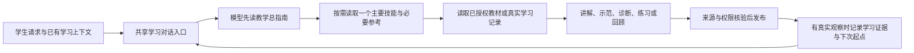

# 学习类 Skill 增量调研：结合现有缺口替换回答框架

日期：2026-11-04。对象：实验心理学课程平台的学生对话。范围：公开技能发现、固定提交源文件/许可审查、当前代码缺口与替换建议。本轮不安装技能，不修改对话代码，不重启8000，不运行上游脚本或模型测试。

## 1. 推荐结论

推荐新增三类能力，而不是继续让全部教学技能处于同一优先级：

- **学习过程主技能：universal-diagnostic-tutor。** 负责根据学习证据选择解释、补前置、纠错、练习、回顾或继续，并在真正有判断时留下下一步记录。
- **连续讲授方法：learn（derwells/learn-skill）。** 适合“我想学习第一章”“继续讲”“这个为什么成立”，解决一轮目录概览之后无法像老师一样带着学的问题。其教学内容匹配度高，但公开使用规模小，应作为实验候选。
- **疑难点与复习衔接：confusion-tracker + exam-review。** 让“刚才没懂的地方”能被再次找到、回顾和核查；复用本项目状态服务，不运行它们自己的文件数据库。

补充候选：Bloom的learn-feynman用于学生解释后的理解检查，myelinate的skill-map用于整理教学任务边界。现有teach-concept、simplify-topic、ai-solution-study等保留为局部方法；不再让一个局部方法独自决定整个会话的教学规则。

最重要的替换点是：把章节、普通问答、选区与练习的内容生成汇入一个学习对话入口，让技能负责教学组织。教材、来源、权限、评分、任务持久化继续由现有平台承担。

## 2. 当前项目缺口：已经有状态系统，缺的是衔接

### 2.1 已读技能，章节回答仍会被固定成导览模板

`agents/chapter_overview.py:183`构造章节输入，`:201`固定拼出“本章地图、逐节核心问题、建议顺序、第一概念、下一步”。`agents/course_prompts.py:64`还要求固定JSON字段、覆盖每节、问号位置与数量；`validate_overview`仍核查相应条件。

该分支已补上技能读取，但技能主要影响字段中的文字，无法完全决定“这一轮只带学生理解一个关系”或“先直接教，再按需要展示地图”。这解释了为什么接入技能后仍可能像目录讲解器。

**替换建议：** 章节包保留为可信教材输入；章号、文档版本、来源和实际覆盖信息保留。内容组织改由主技能决定，停止把固定字段当作每次章节学习的必需教学步骤。请求整体地图时可以给地图，请求开始学习时直接进入一个有价值的学习单元。不能因此假报整章已讲或已掌握。

### 2.2 回答入口仍然分散

`agents/task_service.py:467`直接进入章节总览；学习计划在`:508`进入另一套会话安排生成。普通对话、旧ResponseGenerator、PDF选区、practice_api又分别生成回答。之前“第一章”漏读技能就是一个实际例子。

**替换建议：** 保留宿主对对象、范围、任务和操作授权的判断，各分支准备资料之后进入共享学习生成入口。暂停/取消确认等固定状态回执无需为了形式一致再调用模型。正式评分也不并入自由教学回答。

### 2.3 技能读取与教学执行分成两轮系统

`agents/teaching_skills.py:40`只负责读指南与子技能，读完让模型输出SKILLS_READY，调用方再启动实际生成。它保证了读文件，但不等于已经完成“识别困难—选择帮助—观察回答—决定下一步”的学习循环。

这个助手也没有独立的统一学习状态协议；不能由此说项目没有记忆或教学状态。项目已有TeachingTurn、MisconceptionResolver、Q5与RetentionScheduler，应复用。

**替换建议：** 保留用户要求的每轮先读总指南。后续把读取动作融入现有AgentLoop，减少独立准备阶段的无内容往返；在同一教学流程中按需读技能、检索、解释或等待学生。不叠加一个新的规划Agent。

### 2.4 “调用了什么”还不能在所有入口统一查到

普通循环与章节结果记录了teaching_skills；旧ResponseGenerator、旧PDF选区和practice_api使用`policy, _`，读取收据未统一进入结果。

**替换建议：** 每条需要模型生成的回答统一记录指南版本、实际读取的主要技能/参考、当前活动和停止原因。技能读取记录只能证明读取过，不应作为教学效果已经达成的证据。无需新建复杂观测平台。

### 2.5 当前技能功能重叠，彼此有硬性冲突

多个苏格拉底技能分别要求不同的提示、反问和退出规则；部分解释技能强制附检查题；部分复习技能拒绝总结。若每个技能都按“最高优先级”原样执行，会再次产生相互约束的模板。

**替换建议：** 一轮一个主要教学协议；有需要再加载一个局部方法。总指南明确当前活动边界，局部方法不覆盖主活动。学生要求只听讲、只提示、结束或转题时重新选择适合的主技能。

### 2.6 困难处理和后续回顾缺少统一交付

已有误区、记忆、辅助检查和复习机制；但当前read_skill准备函数本身只读文本，没有统一交付“本轮实际讲过什么、学生展示了什么、未解决什么、下次从哪里继续”。旧策略元数据也未必表示技能实际使用的教学方法。

**替换建议：** 教学观察接入现有服务，记录真实学生原话、给予的帮助、仍未知之处与建议下一步。讲过、自述会了、提示后答对、独立迁移成功分开；建议下一步不直接修改正式掌握度或长期路径。

## 3. 候选清单与成熟度边界

以下stars为本轮读取的GitHub元数据，仅用于发现与维护背景，不代表教学效果。前五项均有MIT许可证，但不因此承诺直接兼容本项目。

| 优先级 | 候选 | 最适合补的缺口 | 可用内容 | 需要改造的部分 |
| --- | --- | --- | --- | --- |
| A | SenmuuuuW/universal-diagnostic-tutor-skill（257 stars） | 教学动作缺少连续闭环，不能有效决定下一步 | Clarify/Diagnose/Intervene/Check/Decide/Carry；next-best-step、multiturn、认知负荷和runtime contract | STEM取向要换成心理学案例；不能每轮强制检查；其状态词和下一步判断需映射宿主，不代替正式评分 |
| A，实验候选 | derwells/learn-skill 的learn（2 stars） | 连续讲课、理由解释、对比案例、插问后回到主线 | lesson-craft、教授式带领、按问题组织课程、必要定义先给、提问不是每轮结尾 | 很小规模；文件型progress/课程/Notebook适配现有系统；可选依赖不假装已安装 |
| A，专项 | ZeKaiNie/universal-examprep-skill（366 stars） | 疑难点记录、备考复习、跨会话回顾 | confusion-tracker、exam-review，必要时exam-tutor的来源使用规则 | 不引入study_state.json第二状态系统；不重写RAG；原共享相对路径与CLI依赖不能当独立SKILL.md直接复制 |
| B | Li-Evan/Bloom 的learn-feynman / learn-graph（仓库300 stars） | 学生复述后的缺口定位与先修分析 | 定位解释不清、跳过的环节；区分前置缺口与概念联系不清 | 与已接ai-novice部分重复；不因口头顺畅判正式掌握；先修关系需依据，不能从图谱邻接猜测 |
| B，设计参考 | baney75/myelinate（6 stars） | 不同学习任务缺少一致的分工与上下文继承 | skill-map区分课堂辅导、独立学习、作业、备考、笔记、检查；帮助强度与独立表现区分 | 完整tutor仍要求每轮一个问题及固定短篇幅；文件记忆与日程不能替换宿主；先借鉴任务契约，不整套当最高规则 |
| C | bevibing/tutor-skills（1386 stars） | 学习笔记、概念追踪、自测面板 | tutor-setup的资料整理与tutor的练习跟踪 | 实际以Obsidian和自测为主；强制会话菜单、零提示问答，不适合普通教学主入口 |
| C | Flagrare/llm-tutor（5 stars） | 会话开始/恢复/结束的完整性 | tutor-start、resume、done及学习路径交接 | 带cycles计费式限额、Bash/jq、角色和状态栏配置；不引入这些与项目无关的机制 |
| C | ShivamGupta42/course-creator（4 stars） | 课程内容与个体学习记录的分离 | tutor-loop与learner-and-knowledge-okf参考 | 主要做静态课程与文件型学习档案，初始尝试与披露阶梯较强；不适合直接替换在线宿主 |
| 暂不直接复制 | HytidelLegend/htd-ai-augmented-education（491 stars） | 资料导航、可恢复课程及双依赖图流程 | build-curriculum-navigation、interactive-tutor的设计 | LICENSE写CC BY-NC 4.0，需先确认用途与授权；完整Python CLI/诊断契约和多份文件不能只读提示词就视为已接通 |
| C，离线参考 | calimike74/music-tech-teaching-skills（0 stars） | 认知负荷与教学问题设计审阅 | cognitive-load-analyser、hinge-question-designer | 音乐技术领域、UK English；CC-BY-SA-4.0；适合作设计参考，不当大学心理学对话主框架 |

这些候选没有哪个可以仅凭README或stars称为“已经验证成熟的大学心理学对话引擎”。本轮核验的是具体机制、文件依赖、许可与适配点。universal-diagnostic的EVALS主要是人工行为检查场景，不等于已有教学增益实验证据；其他仓库有示例或评估脚本，也不能当作本机验收。

## 4. 最值得采用的三个新增部分

### 4.1 universal-diagnostic-tutor：作为诊断与练习活动的主协议

它的价值是把动作串起来，而非增加一条“耐心解释”的提示。对于“我还是分不清被试间与被试内”，可以沿用同一实验场景，定位混淆是处理条件归属、同一被试经历多个水平，还是区组层级；解释必要区别，允许互动时给一个有辨别力的变化，再根据回答决定是否补前置或继续。

重点参考：routing、next_best_teaching_step_protocol、multiturn_tutoring_protocol、cognitive_load_budget_protocol与learning_runtime_contract。后者明确区分观察证据和下一步决策，并要求只在真正有判断时记录。这能补当前“生成一段好回答，但下一轮不知道如何接”的部分。

需要保留学生选择：单纯事实询问不先做长诊断；已经明确只听讲时不强制测验。它的教学状态与正式Q5状态分别映射，不让模型自行宣告正式掌握。

### 4.2 learn：作为系统学习与直接讲授活动的主协议

这是本轮最贴近“像老师带着学”的候选之一：先弄清这节课要解释的问题，准备完整理由、例子与对比，再按学生当前关注的片段交付。必要的定义、符号和前置可以直接教，不让学生猜尚未学过的知识；窄追问可以一句话回答。

对于“我想学习第一章”，建议从当前教材里挑一个有价值的起点，例如“为什么研究心理现象需要实验控制”，用一个可核验或明确假设的案例带入。学生想看全章结构时再显示地图，不先把四节目录全部套成固定段落。

但该仓库目前只有2 stars，使用规模很小，不能按“成熟替代品”直接托付整套系统。优先使用lesson-craft和session组织规则；其文件/Notebook约定接到当前平台能力，不另建个人文件夹数据库。

### 4.3 confusion-tracker / exam-review：作为疑难点与复习专项

疑难点是“我不明白为什么要这样控制”，与一次答错题不是同一个东西。此候选分别记录概念疑问、解释要点和待回顾状态，后续复习时让学习者重新解释，并保留仍未解决的项目。

本项目可复用现有学习证据、误区和复习服务承载，不运行其update_progress.py生成另一份真相。完整包的这类脚本体量较大，本轮只作接口静态检查，未审计全部实现。其exam-tutor的检索/来源规则可参考，现有已核验教材链无需整体替换。

## 5. 哪些看起来合适，但不应作为默认主框架

**Bloom主技能暂不推荐整体替换。** 它主要通过文档而非对话交付；读完反馈后更新syllabus掌握项；要求到最后才给总结，还包含将效果推向+2σ的表述。本轮未取得其软件达到该效果的证据。可单独采用learn-feynman的诊断方法，不采用这些默认推进与效果说法。

**myelinate整体tutor不建议原样全局启用。** 其按课程/作业/学习项目分工有价值，但每轮一个问题和短回复规则会再次覆盖“直接讲清楚”“不提问”的选择。适合从任务地图、反馈和证据字段选取部分设计；不能只因有完整router就引入第二套宿主路由。

**高stars的tutor-skills也不能按名称直接选。** 它实际要求先选择会话类型，再以测验驱动Obsidian概念文件和面板更新，不能替代我们当前的连续讲解。

**HTD需明确授权与工程范围。** 根许可证写的是非商业许可；它有真正的CLI、导航协议和脚本，不能视为随便复制一份MD即可得到的完整功能。本轮不据其公开可读推定可直接迁入。

## 6. 回答框架的具体替换方案

### 6.1 目标流程

宿主继续确定本轮对象、资料范围、用户授权、正式任务和状态；主要技能决定如何教。多个主要技能不在同一轮争夺教法。

### 6.2 建议分工

| 活动 | 主要技能 | 按需的局部方法 |
| --- | --- | --- |
| 我想学习第一章、继续上一段 | learn | 已有teach-concept、reasoning-diagrams |
| 我还是不懂、为什么错、需要练习 | universal-diagnostic-tutor | 已有simplify-topic、misconception-detector、ai-solution-study |
| 我讲一下，你看是否理解 | learn-feynman，或现有ai-novice二选一 | 必要的概念对照，不重复叠加角色 |
| 考前复习、回顾以前的疑难点 | exam-review | confusion-tracker及已核验题目/来源 |
| 从材料建设整套课程 | 已有anything-to-course | 备课设计方法；不作为每条学生问答的默认入口 |

### 6.3 应替换、应保留、应推迟

| 处理 | 对象 | 原因 |
| --- | --- | --- |
| 替换 | 章节固定栏目、固定每轮讲解顺序、旧策略强制的问答节奏 | 这些应让位于教学活动的实际需要 |
| 收敛 | 多个模型生成入口与分散技能收据 | 防止入口漏接，能够核查每轮实际调用 |
| 改接 | 教学观察、建议下一步、疑难点记录 | 接到现有状态服务，区分观察与正式掌握 |
| 保留 | 教材检索、引用/图像核验、课程/会话隔离、任务取消恢复、正式评分 | 新Skill不能替代这些运行能力 |
| 推迟 | 外部课程系统、Obsidian/vault、新建学习数据库、付费/限额cycles、Notebook系统 | 当前回答质量目标不依赖这些额外系统 |

### 6.4 最小可评审实施范围

1. 以当前教学指南为唯一入口，添加少量主技能及其必要references，明确主要技能与辅助技能关系。MIT来源保留版权和许可，固定commit。
2. 将章节总览改为资料准备，交给共享学习生成。保留章号、来源绑定与真实覆盖记录，不强制每次返回全章地图或声称覆盖全部内容。
3. 普通问答、章节、PDF选区、练习辅导共用技能读取与读取收据；正式评分仍独立。固定操作回执不增加无意义的模型调用。
4. 对实际有学习观察的回合，复用现有记忆/证据/复习服务记录；没有学生表现时记为尚未检查，不能给出虚假掌握结论。

首批不建议同时安装十个新仓库。针对性验收应区分“读取了技能”“交付符合技能”“学生独立表现改善”。用户此前选择不先测试，本轮也没有运行；实施时不能把文件已经复制等同于回答框架已经替换完成。

## 7. 来源、固定版本与复核范围

本轮核验10个新候选仓库；下载70份固定提交文本或代码，详读主要技能与选定教学协议，其余按目录、许可、依赖或关键段落抽查。下载不代表全部逐行审计。

| 仓库 | 固定commit | 许可 |
| --- | --- | --- |
| SenmuuuuW/universal-diagnostic-tutor-skill | 075c1895d2559aaa5554e3aab00fd9f83c90fbac | MIT |
| Li-Evan/Bloom | 68788b5e7d3444d92a05c7237f44d1605ff039a8 | MIT |
| bevibing/tutor-skills | 397110c9fefbc6bd5444277686600aec28063c05 | MIT |
| ZeKaiNie/universal-examprep-skill | e01d2f7647b0917172ae8ad5fb788b404e977cae | MIT |
| baney75/myelinate | af31bc317bb32fe05e678a53c0e81f6ab4274539 | MIT |
| derwells/learn-skill | 5e1d484e1236f7ec0483852ded3ce989f91afa10 | MIT |
| Flagrare/llm-tutor | a0413d0a8abbba239ee5280d81a7aa853d4b83ea | MIT |
| HytidelLegend/htd-ai-augmented-education | 638ae84f97a04474cb63c6098eacfc6c83b813af | LICENSE为CC BY-NC 4.0；API标NOASSERTION |
| ShivamGupta42/course-creator | 1d6ddf3b6a2970a20b6dafa0895b2f1ed4ae903e | MIT |
| calimike74/music-tech-teaching-skills | 8e8e64353d7028ebca1d79797b542038713c5afa | CC-BY-SA-4.0 |

主要阅读入口：

- [Universal Diagnostic Tutor](https://github.com/SenmuuuuW/universal-diagnostic-tutor-skill/blob/075c1895d2559aaa5554e3aab00fd9f83c90fbac/skills/universal-diagnostic-tutor/SKILL.md)、[下一教学步](https://github.com/SenmuuuuW/universal-diagnostic-tutor-skill/blob/075c1895d2559aaa5554e3aab00fd9f83c90fbac/skills/universal-diagnostic-tutor/references/next_best_teaching_step_protocol.md)、[状态契约](https://github.com/SenmuuuuW/universal-diagnostic-tutor-skill/blob/075c1895d2559aaa5554e3aab00fd9f83c90fbac/skills/universal-diagnostic-tutor/references/learning_runtime_contract.md)。
- [learn主技能](https://github.com/derwells/learn-skill/blob/5e1d484e1236f7ec0483852ded3ce989f91afa10/skills/learn/SKILL.md)、[lesson-craft](https://github.com/derwells/learn-skill/blob/5e1d484e1236f7ec0483852ded3ce989f91afa10/skills/learn/references/lesson-craft.md)。
- [疑难点跟踪](https://github.com/ZeKaiNie/universal-examprep-skill/blob/e01d2f7647b0917172ae8ad5fb788b404e977cae/full/skills/confusion-tracker/SKILL.md)、[exam-review](https://github.com/ZeKaiNie/universal-examprep-skill/blob/e01d2f7647b0917172ae8ad5fb788b404e977cae/full/skills/exam-review/SKILL.md)。
- [learn-feynman](https://github.com/Li-Evan/Bloom/blob/68788b5e7d3444d92a05c7237f44d1605ff039a8/skills/learn-feynman/SKILL.md)、[Bloom主技能](https://github.com/Li-Evan/Bloom/blob/68788b5e7d3444d92a05c7237f44d1605ff039a8/skills/bloom-tutor/SKILL.md)。
- [myelinate任务地图](https://github.com/baney75/myelinate/blob/af31bc317bb32fe05e678a53c0e81f6ab4274539/references/skill-map.md)、[其tutor硬规则](https://github.com/baney75/myelinate/blob/af31bc317bb32fe05e678a53c0e81f6ab4274539/skills/tutor/SKILL.md)。
- [tutor-skills](https://github.com/bevibing/tutor-skills/blob/397110c9fefbc6bd5444277686600aec28063c05/skills/tutor/SKILL.md)、[Flagrare tutor-start](https://github.com/Flagrare/llm-tutor/blob/a0413d0a8abbba239ee5280d81a7aa853d4b83ea/plugins/llm-tutor/skills/tutor-start/SKILL.md)。
- [HTD许可证](https://github.com/HytidelLegend/htd-ai-augmented-education/blob/638ae84f97a04474cb63c6098eacfc6c83b813af/LICENSE)、[course-creator tutor-loop](https://github.com/ShivamGupta42/course-creator/blob/1d6ddf3b6a2970a20b6dafa0895b2f1ed4ae903e/references/tutor-loop.md)。

工具与限制：使用find-skills的skills.sh/CLI发现和agent-reach的GitHub CLI路线；本机agent-reach CLI/mcporter不可用，公开源码由GitHub CLI/API和标准HTTPS核对。CLI的泛learning搜索包含大量模型自我改进/机器学习技能，未把它们当作学生学习技能推荐。若搜索索引与当前仓库目录不一致，以固定commit的实际文件为准，例如learn当前位于skills/learn/。源码只保存在系统临时目录，研究目录只写报告与来源审计清单。

[SOURCE_AUDIT.json](SOURCE_AUDIT.json)包含逐文件URL、commit、SHA-256、临时路径及当前本地12份相关文件哈希。未安装新增技能、未修改默认教法、未停启服务；以上是可实施的选型建议，不是已完成替换或教学效果验收。
