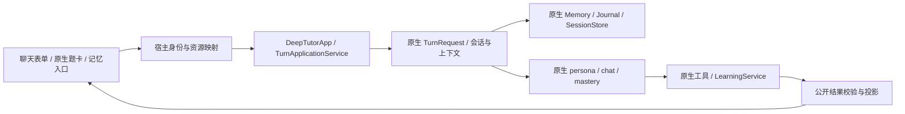

# DeepTutor 整体改造实施计划（主体顺序：1 → 3 → 2）

日期：2026-11-09。状态：实施中，阶段1部分接线已落地并通过真实浏览器回归；整体未完成，详见NATIVE_IMPLEMENTATION_PROGRESS.md。

整体交付包含请求/会话、记忆、教学、练习、两种现有检索适配、本地材料研究、原生回答呈现及Word生成。主体迁移依赖仍为 **1 原生请求与会话绑定 → 3 记忆主体 → 2 教学主体**；阶段4/5及新增能力按关联依赖接入并分别验收，全部必交付项通过后才算整体完成。先前仅做1→3→2的范围已由访谈Q1=B扩展。

目标：已复用的 DeepTutor 原生源码和成功运行的工具保留；自研重叠主体由原生实现接管。不优化旧教学算法，不为了兼容旧算法再实现一层同等功能。每阶段都要在真实产品入口被调用后，才算完成。

对应依据：[深入替换调研](NATIVE_REUSE_REPLACEMENT_RESEARCH.md)、[分阶段图谱依赖](NATIVE_132_GRAPH_DEPENDENCIES.json)、[执行清单](NATIVE_132_TODO.md)。

## 一、图谱依据与范围

D盘：`D:/deeptutor/.ua/knowledge-graph.json`，19123 个节点、38026 条边；架构：`D:/deeptutor/ARCHITECTURE.html`。图谱提交为 `6cf793bd868ba5ecbe64722936d4be8fab5a01df`。`services/llm/factory.py` 有已核对的D盘本地修改，与当前vendor一致。

| 阶段 | 图谱种子文件 | 含调用者及两层依赖的审查文件 | vendor缺失 |
| --- | ---: | ---: | ---: |
| 1 请求与会话 | 96 | 272 | 0 |
| 3 记忆 | 53 | 106 | 0 |
| 2 教学 | 69 | 137 | 0 |

清单按实际 `imports / depends_on / calls` 边提取：模块种子、直接调用者、向下两层依赖。JSON保留节点ID、文件路径和边。审查范围有交叠，数量不代表需要改动所有文件，也不是动态依赖完整性保证。

执行每阶段前重查图谱提交、相关工作区差异和被调用源码。源码已存在且实际使用的部分不重拷；新发现缺失项才补齐同一固定版本的完整模块依赖。

### 本轮保留

- 固定上游的 DeepTutorApp、TurnEngine、TurnExecutor、ContextBuilder、AgentLoop、registries、已经接通的原生能力与工具。
- 隔离worker及已运行的真实模型配置；31个不需要工具继续隐藏。
- 账号/课程/工作区/会话映射、资源访问校验、任务取消与失效控制、公开结果裁剪、SSE、页面回执。
- 已通过真实验证的题卡历史交接、引用和阅读跳转修复，除非本阶段有上游等价接管并通过回归。
- vendor既有补丁，尤其 `learning/policy.py` 的独立证据约束；不得整包覆盖抹掉。

### 跨阶段约束

1. 阶段1→3→2先完成各自接口交接；阶段4练习改用原生主体，阶段5保留现有两种检索引擎并适配原生服务，不另写重复算法。
2. 旧练习提示/批改仍引用旧对象，不能先删全局对象让页面失效。原生主聊天不再依赖整套旧协调器；未迁旧入口仅在其自身被调用时使用现有旧实现，不能成为原生失败后的回退。
3. 旧教材门禁与检索仍属阶段5。此轮保留其调用边界，不宣称所有旧LLM/数据库业务已经从整个产品消失。
4. 不做新的MemoryManager兼容重实现，不在薄接口内复制教学计划、评分、调度、摘要算法。

## 二、最终主链路与阶段验收原则

主线路包括 `/api/chat`、`/api/chat/stream`、同一任务恢复/取消、真实页面题卡提交/跳过与历史恢复。独立测试脚本直接调用某个原生函数不算完成接入。

每阶段必须同时交付：原生模块清单、入口调用证据、数据迁移/映射、旧主体退出证明、对应回归及真实模型/浏览器记录。状态只能在这些证据齐全后标“完成”。

## 三、阶段1：原生请求与会话绑定

### 原生关联模块

- `deeptutor/app/{contracts,facade,service,container}.py`。
- `deeptutor/core/{turn_request,context}.py`。
- `services/session/turns/{request_preparer,context_assembler,executor,lifecycle,learning_adapter}.py` 及图谱中的实际相邻文件。
- `services/session/{context_builder,model_history,source_inventory,sqlite_store,turn_runtime,workspace_preferences}.py`。
- `runtime/coordination/`、`runtime/turn_engine.py`、`agents/loop/`。

关键图谱链：应用服务 → 会话准备/执行 → 原生资源解析/历史预算 → UnifiedContext → capability/AgentLoop。ContextBuilder主要处理历史，不能用单个同名类替换完整装配链。

### 实施任务

**1-A 请求契约。** 以worker中原生 `TurnRequest` 作为最终校验权威，核对宿主 `models/chat_request.py`、`native_contract.py`、`native_bridge.py`、`native_executor.py` 的字段转发。优先接通 `mastery_answer`、`mastery_skip`、`question_notebook_references`、`parent_message_id`，再按实际页面接入跟进题上下文和原生选中文本侧聊。默认值不得改变已有幂等收据。

- UI字段必须沿用原生类型和含义，不另写作答状态机。
- user/workspace/course/session、受管租约、资源归属等服务端字段不接受浏览器越权覆盖。
- `selection_tutor_context`属于父聊天消息选文；PDF继续用原生ReadingReference/Viewport及受校验材料，不能把PDF矩形直接塞进聊天选文契约。
- `auto_route`不再永久写死False，按原生配置与显式能力选择规则处理；显式选中的能力不能被另一层自研路由覆盖。

**1-B 绑定与生命周期。** 复用当前宿主→原生用户/课程/工作区/会话映射；创建、续答、取消、请求重放保持同一submission/turn。现有资源grants不能在重发时被清空；所有外部ID在所属账号/工作区下解析。

**1-C 主聊天装配。** 调整 `main._run_turn` 与原生执行器注入，不再为了一个原生回答构造全部旧路由/规划/生成/质检组件。阶段3未完成前，只显式使用其现存必要服务，不创建仿旧协调器的新包装类。旧练习等尚未迁的调用点只做必要装配兼容，业务保持原样；完整删除旧协调器待全部引用退出后完成。

**1-D 资源交接。** 原生分支不再创建旧TaskContext/旧UnifiedContext来二次理解问题。课本选区、旧习题小题、交互对象仅做服务器资源读取/版本/权限校验，投影为原生reading/notebook/attachment等输入。既有原生ContextBuilder继续唯一负责模型历史与预算。

**1-E 页面接入。** `frontend/native-controls.js`、`frontend/native/entry.tsx`、`frontend/app.js` 和恢复入口同时更新：原生mastery题卡能提交/跳过，动作回到原turn/session；用现有或上游组件的事件契约，不在浏览器判分。普通deep_question练习题不冒充mastery题卡，完整练习评判仍属于阶段4。

**1-F 出口。** 保留当前公开结果过滤、教材发布门禁与阅读动作回执；来源校验主体替换留给阶段5。阶段1不允许原生异常时自动进入旧handle_turn。

### 阶段1完成条件

- 从真实表单分别通过chat与SSE发起原生请求；原生事件和持久结果显示同一账号/会话/turn。
- 重发同request不新增模型调用；断线恢复、取消、等待用户后续答有效；陈旧修订与跨用户ID拒绝。
- 至少一张原生mastery题卡通过页面提交/跳过进入上游处理路径，未调用宿主旧作答状态机。
- 重跑现有“出题→翻到PDF第2页→applied回执→刷新恢复”混合用例，保留页码与私有字段断言。
- 阻断旧 `TutorOrchestrator.handle_turn` 及旧回答生成链调用后，以上原生主聊天入口仍通过。未迁练习入口不在这一阶段的阻断断言范围内。

## 四、阶段3：记忆主体

前置：阶段1完成。记忆应在当前原生用户/工作区下读写，并进入同一条聊天上下文，不只提供一个能单独打开的记忆页面。

### 原生关联模块

- `services/memory/{store,trace,document,ops,paths,ids,settings,recall}.py`、`snapshot/`、`consolidator/`及其prompts。
- `services/learning_journal/{store,models}.py`。
- 原生 `api/routers/{memory,learning_journal}.py`。
- `services/session/{sqlite_store,context_builder,model_history}.py`、`turns/executor.py`；学习记录使用已有 `learning/storage.py`。

关键图谱链：MemoryStore → document/ops/paths/trace/consolidator；原生TurnExecutor → MemoryStore/JournalStore → UnifiedContext。不能把所有旧MemoryManager数据都塞进一个preferences文件。

### 实施任务

**3-A 明确唯一存储。** 对话和模型历史归SessionStore；长期偏好/画像文字归MemoryStore；学习使命/交接/洞见归LearningJournalStore；正式学习证据和路径进度归LearningStore。宿主继续保存身份、失效epoch、授权/发布收据和必要公开投影，不运行第二套会话摘要或学习状态算法。

**3-B 一次迁移。** 生成迁移预览、源数据快照、数量/关联校验与可重跑ledger。先用隔离账号验证：旧已确认偏好转原生条目，保留确认来源；旧历史导入后保留旧ID→原生ID关联。不能可靠映射的旧进度只读归档，不换算成原生“独立掌握”。不清空正式库；切换后新写入不再双维护两套记忆主体。

**3-C 主回答读取。** 替换 `native_executor.py` 对旧 `MemoryManager.get_profile/get_history/read_version/append_exchange` 的业务依赖。身份/epoch检查从既有授权与Repository边界读取；偏好与历史由原生store读取。原生 `memory_references` 使用 `recent/profile/scope/preferences/summary` 契约，根据实际选择进入上下文；测试必须看到有效注入，不能仅证明文件存在。

**3-D 历史公开语义。** 原生存储含内部回合与私有结果，不能直接原样返回页面。继续以宿主发布收据过滤未发布/拒绝结果，复用安全公开投影，保留引用、题卡、turn来源及恢复映射；不把原生内部前言和答案键暴露为已发布对话。

**3-E 页面与API。** 改 `memory_api.py`、`web_api.py` 的历史/偏好/记忆入口及页面设置、历史恢复。新页面采用原生Memory/Journal/Profile字段，不再运行7维策略映射算法。需要上游组件时同时接入其API/i18n/workspace依赖；现有宿主壳可以只做展示与传输，不复制业务判断。

**3-F 生命周期。** 原生记忆更新/合并调用上游consolidator及原生LLM配置，停止原生模式下的旧MemoryWorker。当前 `memory_lifespan` 还承担fixed_book启动/停止，必须拆分生命周期职责；检索资源按阶段5适配后的实际需要继续保留，不能因删除旧记忆任务而整段删除。

**3-G 修改/删除。** 编辑与删除调用原生doc/entry接口；删除相应数据时仍使受影响的旧任务/请求失效并取消活跃回合，防止恢复后复活旧记忆。原生访问控制和必要宿主失效控制不可丢失。依靠原生trace/entry身份实现幂等，不自研第二个记忆版本算法。

### 阶段3完成条件

- 真实聊天调用原生write_memory，另起会话显式选择相应memory reference后读到同一原生偏好；用户B无法读取用户A的内容。
- 页面修改/删除的结果与模型随后读取一致；陈旧请求无法恢复已删除记忆。
- 刷新恢复已发布题卡和PDF引用；被拒绝的内部回合不会变成正式历史。
- 停止旧MemoryWorker并阻断旧MemoryManager的偏好/历史/摘要业务方法后，原生主聊天及记忆页面仍通过；授权/发布收据仍正常。
- 一次迁移重复执行不重复造条目；有可验证的恢复步骤，旧源数据仍可追溯。

## 五、阶段2：教学主体

前置：阶段3完成。教学以刚接通的原生记忆与原生会话为输入，不能再依赖旧画像来选择另一套教学计划。

### 原生关联模块

- `services/persona/service.py`、`presets/*/PERSONA.md`、`api/routers/personas.py`。
- `multi_user/learner_profile.py`，`learning/models.py`的原生路径画像与teaching_strategy。
- `capabilities/mastery/{capability,pipeline,loop,mode,binding,tools,choices}.py`及中英文prompts。
- `learning/{service,storage,policy,grading,mastery,scheduler,pending,question_card,assessment}.py`。
- `services/session/turns/learning_adapter.py`、`agents/loop/{pipeline,prompt_blocks}.py`、`tools/ask_user.py`。

关键图谱链：mastery tools → LearningService/LearningStore → policy/grading/scheduler；MasteryPromptAssembler → 同一个原生AgentLoop。教学判断交给原生模型/工具协议，计算和事务由原生引擎负责。

### 实施任务

**2-A 去掉自研教学注入。** 原生入口不再运行 `agents/teaching_strategy.py`、`teaching_policy.py`、`task_execution.py` 的策略选择与教案moves；撤去 `teaching_prompt_adapter.py` 对LoopPromptAssembler.blocks的自研计划注入。页面改用原生persona/profile/mastery模式，不另建13策略兼容器。

**2-B 用原生教学设置。** persona由用户明确选择，普通chat默认不强套teacher；原生mastery采用自身outline/study/review及probe_first/teach_first等协议。界面与服务端都以原生字段为准，实际默认值通过该固定版本源码确认，不把旧mode名硬映射成一套新决策。

**2-C 恢复原生服务主体。** 保留现有LearningService/LearningStore及已复用源码，退出HostAssessmentService/HostAssessmentStore中自研评分与事件改写、强制scheduler=None等业务覆盖。题卡提交/跳过进入原生LearningTurnAdapter和原生方法，不再由AssessmentCommands实现另一套教学命令。

- 这不等于删除所有授权包装：若原生store外还需宿主task/epoch访问校验，只保留不改评分/调度结果的授权注入；事务失效检查必须等价有效。
- `learning_binding_adapter`的路径switch/leave按实际调用逐条拆分：优先上游binding，宿主只维护必要身份映射与授权收据，不在handoff中决定教学或成绩。
- 当前已声明的vendor/policy独立证据补丁保留，专项测试证明它未被本次服务切换抹掉。

**2-D 两类题卡分清。** mastery题卡的作答、跳过、定性评估与状态更新沿用原生工具；deep_question普通出题继续走既有原生QuestionPipeline和公开题卡投影。正式教材练习ai_parts及完整practice业务属于阶段4，本轮不宣称已被替换。

**2-E 持久化与恢复。** 原生学习进度、待答题和复习状态存到阶段3确定的同一原生LearningStore；刷新、断线续答及另开会话读取原生状态。公开边界继续过滤私有答案，查看解析和作答按原生能力及授权语义处理。

### 阶段2完成条件

- 普通chat、明确选择的persona和mastery路径各从真实页面进入原生代码；不调用旧教学策略/计划生成器。
- 原生出题→作答→评分/跳过→状态持久化→刷新恢复完整通过；重复提交、陈旧题目、跨用户访问被正确处理。
- 原生规则评分、掌握闸门和scheduler保持运行；核对受助/独立证据标签及已有policy补丁，不能把提示后正确作答误当未受助证据。
- 当前明确要求“只翻到第2页”时不续讲旧题；保留现有混合链路的实际页码/applied回执/题卡恢复断言。
- 阻断旧教学策略函数、HostAssessmentService/Store业务改写及AssessmentCommands接管后，以上主线仍通过。

## 六、实施与验证安排

### 顺序与交付

| 顺序 | 交付物 | 进入下一阶段的条件 |
| --- | --- | --- |
| 1 | 原生请求/身份/资源完整绑定；真实题卡和恢复入口接通 | 阶段1完成条件全部有证据 |
| 3 | 原生存储、一次迁移、记忆页面及聊天上下文接通 | 阶段3完成条件全部有证据 |
| 2 | 原生教学/学习服务接管，自研策略和业务覆盖退出 | 阶段2完成条件全部有证据 |

每阶段保持可审查变更与独立验收记录；不把“文件存在”“模型说成功”“孤立函数可运行”当作主线路完成。不得先关掉旧入口再长期留下未接线功能。

### 验证范围

- 复用并按最终行为更新现有 `test_native_executor`、`test_deeptutor_native_runtime`、`test_native_tool_policy`、`test_native_delivery`、`test_native_reading_scope`、`test_native_question_history`、`test_native_grounding`。
- `test_native_teaching_prompt`等依赖旧host_teaching_style的断言应改为原生persona/profile/mastery行为验证；不能仅删断言换取通过。保留必要偏好隔离、收据和用户边界测试。
- 新增少量有意义的契约/迁移/状态边界用例；对原生已经覆盖的算法直接使用其测试，不逐行复制测试或重新实现算法。
- 扩展现有 `scripts/check_native_chat_chain.py` 与 `check_native_delivery_browser.py --live`，保留原生事件、tool结果、store记录、公开结果和页面回执证据。使用隔离用户、数据库、原生home，不改正式学生数据；真实模型沿用已授权的DeepSeek配置。
- “旧主体未调用”由测试阻断和运行事件共同证明。阻断名单按阶段范围设定，不把尚未迁移的阶段4/5误算本轮已退出。
- 当前旧教学链5项既有测试错误单列台账，不掩盖，也不把修复它们变成本轮原生迁移目标。

### 恢复与数据安全

源码回退与数据恢复分开处理：切换前留存旧数据快照/映射ledger；新原生记录单独保存，不通过回退代码覆盖新数据。失败阶段停止切换，保留原请求及已落地结果以便幂等恢复；不能自动调用旧生成器作为兜底。

正式实施须在每次数据变更前生成具体迁移预览和影响清单。此次仅写计划，不执行正式迁移，不删除旧数据。

## 七、本轮结束时允许宣称的结果

阶段完成时仅可宣称对应范围已接入且旧重叠业务退出。整体完成还须练习、两种检索适配、本地研究、原生回答展示和Word生成等必交付链路全部有验收证据。

不能仅凭阶段1→3→2通过就宣称整体完成；不能宣称全部tools/capabilities或所有旧历史都已迁移。阶段5目标是保留两种现有引擎并适配，不是全部替换检索算法；未迁、归档及非必交付项明确列出。

## 八、教材检索方案修订：保留现有两种引擎

2026-11-09用户确认：保留现有能运行的legacy/local_llamaindex两种检索方式，改造后接入DeepTutor。此前调研要求整体退出宿主检索算法、重建原生索引的方向由本节替代；主体依赖仍为1→3→2；阶段5已由后续访谈Q1=B纳入整体交付，本节列出其接入要求，不表示已开始实施。

现状：knowledge/psychology_retrieval.py通过RAG_RETRIEVAL_ENGINE在legacy和local_llamaindex间切换，当前不是同时双路检索。local_llamaindex使用LlamaIndex组件并读取现有SQLite片段与向量，不等于DeepTutor原生KB pipeline。heart_rag.py已通过覆盖rag/kb_files接入现有查询，但完整KB服务与生命周期尚未接通。

实施要求：

1. 保留两种检索实现、教材解析、现有索引和向量；按现有配置选择。不新增同时双路融合，不默认全量重建或重算向量。
2. 优先在原生RAGService的pipeline/provider层接入现有后端，保留原生工具和事件链。一起核对factory、provider_binding、index_probe、KB清单及新增/删除调用者；不能仅改factory或让未知provider静默退到llamaindex。
3. 明确固定教材只读索引的支持范围，不伪装支持任意资料写入；现有SQLite不能只改名冒充原生索引。仅转换确有契约差异的部分，保存原件和ID映射。
4. 统一课程/KB/文档身份、资料权限、版本hash、页码、章节和原文范围，适配原生sources及Reading引用，不伪造来源字段。kb_files列出实际授权资料。
5. 接通原生会话/AgentLoop→原生rag/RAGService→选定现有引擎→来源结果→回答引用→阅读器/applied回执→刷新恢复。通过回归后再撤销同名工具覆盖和绕过KB挂载条件的补丁，不能提前断开现有查询。
6. 两种引擎分别从真实聊天入口验收：概念查询、指定章页、原文/表格、空结果、不可用引擎、陈旧索引/来源与跨用户访问；核对向量模型身份/维度和重排状态。排序分数不当相关性概率，翻页成功与引句核实分别记录。
7. 未完成的KB导入/更新/删除能力单列，不能以search接通宣称全生命周期完成；非必要工具保持隐藏。

## 九、输入理解调研与补充验收

依据：D:/deeptutor/.ua/knowledge-graph.json与ARCHITECTURE.html；图谱提交6cf793bd868ba5ecbe64722936d4be8fab5a01df与当前HEAD一致。存在已知LLM factory修改及图谱外本地配置，图谱不能代替源码/动态调用核验。架构图把上下文装配概括为Context builder；源码中context_builder主要处理历史与预算，完整UnifiedContext由turns/executor及关联准备逻辑装配，不能只迁一个同名文件。

原生关联链：TurnRequest→TurnApplicationService及会话准备/执行→request_preparer/context_assembler/context_builder/model_history/source_inventory→UnifiedContext→TurnEngine/capability→AgentLoop。图谱已核对request_preparer对TurnRequest/capability_routing的依赖，以及context_builder对model_history等的依赖。

当前结论：主干已接入，但输入理解未完整接管。NativeTurnOptions仍缺mastery_answer/mastery_skip/question_notebook_references/parent_message_id/followup_question_context/selection_tutor_context等；bridge固定auto_route=False；executor仍调用旧TaskContextBuilder（会装配旧UnifiedContext），teaching_prompt_adapter仍从旧规则产生讲法/策略约束。不能把这些都视为原生输入理解已经完成。

补充任务1-H（与1-A/1-D、2-A一起执行）：

- 用原生请求、上下文、历史和能力契约接管输入。宿主只做显式资源定位、权限/版本校验和收据；不再构造旧理解上下文或复制通用意图分类器。
- 恢复原生auto_route配置和显式能力/工作区语义。原生capability_routing只做明确生成测验题集的窄规则预路由，interactive quiz留chat，workspace有保护；打开开关不等于已有通用多意图路由。其余自然语言由原生模型结合上下文理解。
- 验收矩阵：普通解释；有效历史中的“这个/刚才那题”及歧义澄清；生成题集与交互提问；出题后仅翻页/否定翻页；PDF选区与聊天选文；题卡作答/跳过；课程交互对象引用；换话题/取消/刷新。多意图逐项记录实际执行范围，不凭回复宣称动作完成。
- 保存实际模型输入、能力/工具事件及页面结果，过滤私有答案；阶段1验契约/上下文，阶段2再阻断旧教学注入复验。已有真实“出题后翻到第2页”通过证据保留，但不代替完整矩阵验收。

## 十、Skill与回答展示调研及改造方向

2026-11-09用户要求回答版式更灵活，将本次调研纳入整个改造计划。本节为已确认方向与待访谈设计，尚未实施；不能将展示目标直接视为已批准迁移全部上游前端或所有外部工具。

### 源码依据与现状

- D盘知识图谱中services/skill/runtime.py依赖skill/service.py，prompt_blocks.py依赖core/context.py；ARCHITECTURE.html列出Skills & prompts、read_skill/exec及Visualizers。前端不在该图谱分析范围，展示结论以web源码为准。
- 原生内置5个skill：pdf/docx/pptx/xlsx/skill-creator。工作区、账号、管理员授权、内置来源依次解析，同名优先级及资源选择由原生runtime负责。
- 原生路线：用户/工作区可见技能→本轮资源筛选→skill_manifest→UnifiedContext.skills_manifest→LoopPromptAssembler→模型按需read_skill读取SKILL.md/参考文件→依说明调用工具。always且available的技能存在直接加载正文分支，不能概括成所有技能都只加载摘要。
- 宿主已有skills字段、资源选择页面及原生runtime/read_skill；受控模型HTTP链已验证读取pdf技能。未完成真实模型自主选技能→exec等实际工作→生成文件→校验→授权下载/恢复的全链验收。文档skill读取成功不等于文件制作成功；执行工具和依赖必须按实际任务核验。
- 回答多样性来自模型/persona/能力提示的内容组织、capability结构化产物、tool具体动作及前端渲染，不是单个skill。普通Markdown表格/公式/流程图不必先调skill；visualize通过submit_visualization交付画布，文档任务才主要使用文档skill。
- 原生web/components/common/AssistantResponse、MarkdownRenderer、RichMarkdownRenderer处理流式正文、Markdown、公式、代码、Mermaid、图片/链接等；ChatMessageList按事件/结构化结果选择题卡、研究、掌握学习、可视化等组件。
- 宿主已复用VisualizationViewer及相关结果解析，但frontend/native/entry.tsx、chat-renderer.js、reader/src/tutor/markdown.tsx仍有自己的题目、正文及文件展示；因此后端原生化不等于原生展示能力已完整接入。

### 实施原则与待确定设计

1. 保留已经运行的原生组件，优先复用完整原生正文渲染及对应能力结果组件；连同状态、样式、依赖和事件契约适配到现有页面。不另造第二套版式决策器，不仅加CSS或靠新增skill解决展示差异。
2. 核对旧正文清洗、learning-response块展示和native_result投影对原生内容的影响，避免丢失结构、链接、图表与文件；退出重复格式转换时保留来源权限、私有答案过滤和已发布结果边界。
3. 真实聊天、流式更新、完成结果、历史刷新走一致展示语义。检验表格/公式/代码/流程图、题卡交互、可视化画布、文件/媒体、引用定位，避免只验静态截图。适用的长内容、窄屏、键盘操作和失败反馈一并验收。
4. skill继续使用原生解析/读取；文件制作作为独立端到端验收，覆盖执行依赖、文件实际存在且可打开、授权访问与刷新恢复。不重建宿主skill引擎。
5. 具体展示范围、模型自动选择与用户指定的关系、是否引入独立产物区域、交付顺序和首批验收场景由整计划访谈明确；未回答的选择保持待决，不默认扩展所有媒体/文档能力。

### tools/capabilities证据边界

沿用TOOL_STATUS.md及后续修复记录：100工具可实例化，31项隐藏、69项为候选范围；19项有实际调用链证据但部分由受控模型驱动，不代表全部真实模型验收。11个能力中7个有入口运行证据；deep_research/math_animator/audio_overview/mastery_path尚未全部验收。其余mastery、材料/批注、课程编辑/交接、题库、工作区/笔记本操作按产品需要逐项补接；工具能调用也不等于旧评分/记忆业务覆盖已经退出。

原有7条能力运行证据仍需按最终迁移后的契约复验。继续隐藏不需要的工具，不以全量工具通过作为目标；建立所需功能→页面入口→能力/工具→数据源→结果组件→真实验收证据的对应清单。

## 十一、整份改造计划的逐题审查

用户明确追问范围是整份改造计划，不限回答版式。采用逐题追问，先解决会影响后续设计的交付范围和数据权威，再讨论展示细节；每轮记录已决事项、未决事项和对应计划修改，不重复询问已授权原则。

访谈范围：本轮与后续交付边界；1→3→2及练习4/教材5/展示的依赖与顺序；旧业务退出与接口保留；历史/偏好/学习记录迁移与恢复；原生输入/指代/工作区语义；两种检索与来源契约；练习/正式评分；所需skill/tools/capabilities和外部依赖；回答呈现与产物交互；真实模型/浏览器验收及切换标准。

已确认原则不重开：已复用原生代码保留，自研重叠主体由原生接管且必须接主线；成功且需要的工具保留，不需要的隐藏；保留两种检索引擎并适配原生服务；回答版式更灵活。当前执行顺序仍1→3→2，扩展交付范围和新顺序需访谈明确，不能自行假定。

技能说明：本机grill-me/SKILL.md仅要求运行/grilling，未找到该命令定义；本次如实采用逐题深入访谈，不声称已运行缺失命令。

### 访谈决策 Q1：整体交付边界（已确认B）

2026-11-09用户选择B：本次为整体交付，包含1→3→2主体迁移、练习主体4、教材检索适配5（保留两种现有引擎）、灵活回答展示及项目需要的skill/tools/capabilities。保留1→3→2依赖，各阶段独立验收；所有纳入范围的功能均接入真实主线路并通过对应验收后，才可宣称本次整体改造完成。

此决定扩展此前“本轮只实施1→3→2”的交付边界；前文第七节仅适用于1→3→2阶段结果，不能当作本次整体完成标准。第八节教材检索及第十节展示已进入本次整体交付范围；4/5/展示的详细实施顺序及具体所需能力继续访谈确定，不把所有可选外部集成都默认纳入。

待决Q2：mastery_path之外，deep_research、math_animator、audio_overview是否属于本次必交付能力，以及其使用场景；未选择前不擅自启用或隐藏。

### 访谈决策 Q2：可选能力范围

用户回复“1”，按上一轮表格顺序记录为选择deep_research：纳入本次必交付，要求页面可用、真实执行、结果可查看及刷新恢复。math_animator与audio_overview暂未选入必交付范围，保留已有实现；未据此自动修改能力目录或隐藏策略。mastery_path仍属于既定教学迁移。

待决Q3：deep_research使用公开网络/学术来源与课程材料联合研究，还是限定课程与上传资料；具体联网工具和外部服务按所选范围接入，不默认要求全部外部工具跑通。

### 访谈决策 Q3：研究资料范围（已确认2）

用户选择仅课程教材与用户上传资料：本次deep_research限定为当前用户有权访问、明确用于研究的课程/上传材料，不主动访问公开网络或学术搜索。不得因deep_research名称而默认启用联网工具或要求配置全部外部搜索服务。

实施前核对原生研究pipeline、提示、工具清单、材料检索与报告引用是否支持该范围；优先复用原生资料研究能力，存在外部依赖时明确适配项及限制，不能仅禁用搜索便宣称完成本地研究。原始材料、研究报告及引用应可追溯；材料不足时应如实指出或请求补充，不伪造外部检索结果。

待决Q4：统一聊天入口的能力启动方式：模型/系统按需求选择，或由用户明确选择研究、解题、出题、可视化等能力。先确定产品行为，再核对原生路由是否覆盖，不能把原生窄规则路由当通用自动选择。

### 访谈决策 Q4：统一聊天自动选择能力（已确认1）

用户选择统一聊天自动选择能力，同时保留手动指定。自然语言提出研究、解题、生成题集、可视化等明确任务后，系统应直接选择相应已接入能力，不要求先到菜单切换，也不统一增加启动确认。歧义或关键资料不足才澄清；显式手动指定按所选能力执行，不被另一层推断静默覆盖。

这扩展了当前原生仅对明确生成测验题集进行窄规则预路由的覆盖。实施前沿图谱核对原生请求准备、capability manifests、工作区绑定、工具与能力的边界，优先复用已有机制；缺失的自动选择能力单独设计最小路由接入，不恢复整套旧教学路由/规划，也不能仅开启auto_route就标记完成。

权限、资料范围与所选工具白名单仍在服务端校验；deep_research仍限定课程/上传资料，不因自动选择能力而联网。纯翻页等单工具动作不应被升级为完整研究/教学任务。验收包括明确请求自动命中、歧义澄清、手动选择优先、工作区承诺和中途任务切换，以及实际能力事件与结果的一致性。

待决Q5：进行学习/研究时收到新任务，旧任务保留暂停后由用户主动恢复，还是新任务结束后自动续回；涉及题卡、路径、工作区和持久恢复语义。

### 访谈决策 Q5：任务切换与恢复（已确认1）

用户选择新请求优先：切换到不同任务时保留旧任务的待答题、学习进度和必要上下文，旧任务暂停；新任务完成后保持当前话题，不自动续回旧教学/研究流程。用户明确要求继续时恢复原任务；多个可恢复目标无法明确对应时才澄清。

暂停是产品任务语义，不代表可无限挂起原生执行租约或后台模型调用。实施须核对原生turn生命周期、工作区绑定与持久恢复接口，在安全结束/取消在途执行和保存可恢复业务状态之间作明确交接，不重复生成已交付结果，不把旧任务私有答案或材料授权带入新任务。应用重启/刷新后仍按同样规则恢复；纯翻页/检索等当前任务内工具动作不当然视为换任务。

待决Q6：旧历史、偏好、学习记录和成绩的切换策略：全部能迁后整体切换，或原生新记录启用且旧数据可追溯只读保留、可靠映射部分逐步迁入。已确认不可把不可靠旧成绩冒充原生独立掌握证据，此约束不重开。

### 访谈决策 Q6：旧数据迁移与切换（已确认1）

用户选择分开处理：可靠映射的聊天历史、偏好、学习进度、错题和成绩按类别迁入原生系统；暂不能可靠转换的数据保留为可查看、可追溯的只读档案，不阻塞新链路启用。禁止将不可靠旧成绩换算成原生独立掌握证据。

仍需迁移预览、快照、ID映射、幂等ledger和可验证恢复步骤。新链读取迁入的原生数据，不靠旧业务引擎继续计算；只读档案页面标明来源与历史状态。资料授权、私有答案与公开历史过滤不因归档放宽。整体交付须有归档访问和已迁数量/未迁原因的清单，不以此决定允许遗漏或删除旧数据。

待决Q7：练习迁移后是否必须保留现有章节测验、百分制总分/及格判定的产品契约，还是采用原生练习/反馈/掌握度语义；需区分原生客观题判定、定性AI反馈和正式成绩。

### 访谈决策 Q7：练习与评分语义（已确认2）

用户选择DeepTutor原生练习方式：新练习展示客观题对错、定性题反馈、错题/复习状态与掌握度进度，不要求复现旧章节测验的百分制总分及及格规则。采用原生practice/question notebook/quiz_judge/assessment及其页面契约，不为旧分制继续保留第二套评分算法。

旧成绩仍按Q6可靠迁移或只读归档，不能因新产品不再使用百分制而删除历史。现有章节结构可作为课程范围/筛选数据，不等于保留旧评分引擎。原生check_answer对无法客观判定的题返回None时保留该语义；AI反馈与可信学习证据按原生规则区分，并保留既有独立证据补丁。

待决Q8：普通回答版式由模型根据内容自由组织（保留用户显式格式要求），还是用户每次先选择固定版式；交互画布/文件制作仍受实际能力和工具执行结果约束。

### 访谈决策 Q8：回答版式沿用DeepTutor原生实现

用户明确“deeptutor是怎么做的，我们就怎么做”。回答呈现以固定版本原生行为为准：复用原生提示组织、AssistantResponse/MarkdownRenderer及对应能力结果组件，不另设计固定版式模板、版式选择器或宿主自动排版决策算法。普通正文与结构化能力产物遵循各自原生协议，不将所有表达形式强制变成工具调用，也不强制每次出图。

迁移完整关联依赖和实际消息入口，覆盖流式/完成/历史恢复；现有已复用组件保留。退出与原生呈现重叠的旧正文清洗/块转换时验证内容无丢失。用户与资源身份映射、授权、私有答案过滤及来源回执仍需适配，不能因为前端直接复用而绕过。

原生源码可回答的实现细节自行调研，不继续要求用户选择；访谈仅继续确认产品范围和无法由源码推导的取舍。此决定针对回答呈现，不撤销先前已确认的自动能力选择、本地材料研究、两种现有检索及旧数据策略。

待决Q9：文档skill的PDF/Word/PPT/Excel文件生成哪些属于本次必交付；原生skill存在不代表所有文件任务都已验收或都必需。

### 访谈决策 Q9：文件生成必交付范围（Word）

用户选择Word：本次必须完成原生docx skill的真实模型端到端任务，包含技能读取、实际执行、生成可打开的.docx、结果校验、按用户/任务授权下载及历史恢复。页面生成说明不能替代实际文件；不另写宿主文档生成算法。

PDF/PPT/Excel文件生成不作为本次必交付，保留已有原生源码，不据此擅自删除或变更目录开放策略。既有教材PDF读取、引用与阅读器仍属本次范围，此处仅限定文件生成任务。

待决Q10：正式入口切换策略：隔离环境完成分阶段与整体验收后一次性切换，或在阶段验收后逐步切换实际入口。任何方式均保留数据快照和已交付新结果，不在原生失败时自动回退旧生成链。

### 访谈决策 Q10：正式入口切换（已确认1）

用户选择隔离环境整体验收后一次切换正式入口。实施/阶段验证使用隔离用户、数据库、原生home和教材副本，逐阶段保存证据，再验证整个产品主链；正式数据迁移与正式入口切换不能由隔离验证替代。切换前核对实际配置、迁移预览/快照/映射及恢复步骤；沿用Q6可靠迁移和只读归档。失败不能自动调用旧生成/教学链，新产生的数据和交付结果必须保留。

本次关键范围与取舍已明确，访谈不再让用户重复决定原生源码能回答的实现细节。实现中发现会改变已确认范围或数据语义的问题时，再提出针对性问题。

## 十二、整体交付确认清单

| 内容 | 已确认目标 |
| --- | --- |
| 主体迁移 | 1→3→2；已复用保留，自研重叠主体由原生接管并接主线 |
| 入口 | 统一聊天自动选择能力，保留手动指定；原生缺失路由覆盖需补接验证 |
| 任务切换 | 新任务优先，旧任务暂停保留，用户明确要求才恢复 |
| 旧数据 | 可靠映射迁入，其余可追溯只读归档，不阻塞新链启用 |
| 练习 | 原生对错/定性反馈/复习/掌握度语义，不复现旧百分制及格规则 |
| 检索 | 保留legacy和local_llamaindex，适配原生服务及引用/阅读链 |
| 研究 | deep_research必交付，仅课程与用户上传资料，不主动联网 |
| 回答呈现 | 直接复用原生正文和能力结果组件，包含流式及历史恢复 |
| 文件生成 | Word必交付；PDF/PPT/Excel生成不要求本轮跑通 |
| 能力范围 | mastery等既定教学能力保留；动画/音频概览暂未纳入必交付，非必要工具继续隐藏 |
| 切换 | 隔离环境阶段及整体验收通过后，一次切换正式入口 |

整体验收覆盖统一输入自动选能力、原生上下文、记忆与学习状态、任务切换恢复、原生练习、本地材料研究、两种检索来源/阅读回执、原生回答组件及Word授权交付。对所有纳入范围的功能记录页面入口、实际调用、唯一数据源、结果展示、异常与恢复；不得以注册成功或受控模型单测代替真实模型/浏览器验收。详细改动与测试继续按图谱依赖和实际调用源码展开。
