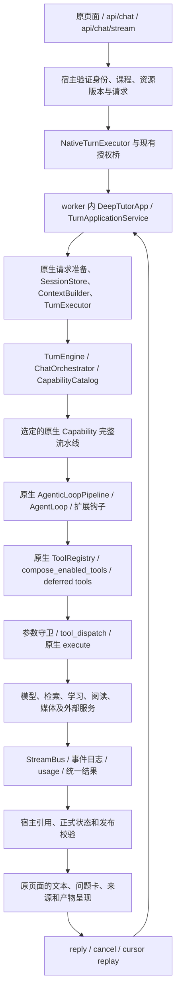

# 第二部分迁入方案：完整原生运行内核、Tools 与 Capabilities

日期：2026-11-08。状态：实施中；已完成 B0 原生执行内核与页面目录接线，能力/工具逐项验收尚未全部完成，进度见 [PHASE2_PROGRESS.md](PHASE2_PROGRESS.md)。

## 最新执行范围（以用户本次指令为准）

不再以“100 个工具全部跑通”为验收目标。已成功运行的保留；当前教学项目需要但未跑通的补接；不需要的隐藏并停止验收。现已隐藏 31 个工具和对应 6 个循环扩展，其余 69 个作为项目候选范围，按实际调用需求继续验收。下面的完整来源清单保留作审计依据，不代表全部项目均须实施。

## 目标与完成定义

迁入并在用户实际入口中调用完整的原生运行链路，范围为 **100 个内置工具、11 个回合能力、14 个循环扩展，以及动态 MCP/CLI/plugin 提供者**。第一部分尚未对齐的上下文装配、快照重放、provider 状态、窗口保护和事件生命周期一并补齐。

按“能力包 + 必要运行依赖”接入，不按单文件复制。已有且等价的迁入实现、数据服务、许可证与验证通过的适配器保留；自实现的同职责循环、工具协议/调度、扩展元数据假实现和能力流水线由原生实现接管。同名工具不自动视为等价。

验收状态必须区分：源码存在、目录登记、可挂载、已执行、产物已发布、真实链路已验证。只有最后一项可以标为完成。缺少配置的外部服务标 missing_config；它们仍在迁入范围，不能据此把相关包排除或算作已通过。

## 1. 核对后的事实与当前阻塞

- 第一部分仅接通选定上下文子集，完整性结论见 PHASE1_AUDIT.md；当前 19 项测试通过不等于原生行为全覆盖。
- 全部需要的 Python 原版源码已在 project/vendor/DeepTutor。依据注册表、运行内核和静态 imports，生成了 975 个候选依赖文件，vendor 缺失 0 个；列表见 SOURCE_FILES.txt。静态闭包已纳入真实 worker 使用的 api.main；仍不是动态资源或外部程序清单的替代品。完整包有 3764 个已登记文件，见 VENDOR_PACKAGE_FILES.txt，整体保留，不按静态闭包裁包。
- D 盘与候选 vendor 文件有 3 个差异：learning/policy.py、multi_user/paths.py、utils/secret_files.py。它们对应既有本地补丁；实施前复核 UPSTREAM_SNAPSHOT.json 声明与哈希，保留已验证补丁，不盲目用 D 盘覆盖。
- 宿主静态找到 24 个工具定义，其中与原生 100 个工具同名的只有 20 个；同名不证明参数、返回或授权一致。其他原生工具主要只是随 vendor 源码存在。
- ChatRequest 没有 capability、tools、config、通用附件和原生资源选择字段。当前 main 入口仍选择 LocalAgentLoop。
- NativeTurnStart 只允许 chat/ask_questions；NativeTurnBridge.start 强制 tools=[]、knowledge_bases=[]。account() 还会以空 grant 覆盖工具/MCP/CLI/exec 权限，已有配置不能在此模式下自然生效。
- agents/tools/extensions.py 的 14 项是带 pending_business/not_applicable 状态的目录/激活元数据；不能当成原生钩子流水线已经执行。
- agentic_bridge.py 的现有模式只允许本轮 read_current_evidence，主动返回空的 active loop capabilities；不能把它当作全功能 AgentLoop。

## 2. 路线选择

| 路线 | 结果与代价 | 选择 |
| --- | --- | --- |
| 复用现有独立 worker + 整个 vendor 原生 SDK/runtime，替换宿主默认执行入口 | 已有独立环境、账号映射、原生 start/events/reply/cancel 和授权适配可复用；原版动态导入、提示词、服务和插件不需再手工拆散 | **推荐** |
| 在宿主进程中加载整套原生 SDK/runtime | 同样可实现，但需统一 Python 依赖、进程全局设置、用户作用域和事件循环，现有 worker 的隔离收益丢失 | 不作为本次首选 |
| 继续把单个 Tool/Capability 文件搬到自实现 LocalAgentLoop | 会留下协议、挂载、钩子、状态机与资源依赖缺口，并维持两套循环 | 不满足目标 |

采用第一条。不是再复制另一份 DeepTutor，而是让现有全量源码成为默认执行内核；宿主提供身份、资源、正式教学状态和公开结果边界。已经迁入且行为一致的文件不重写。

## 3. 目标真实链路

只有原生 turn runtime 拥有“生成执行状态、工具循环、等待答复、取消和事件序号”。宿主保留请求归属、正式教材/学生状态和公开发布收据；它们是边界与投影，不再维持第二套生成状态机。

用户同一次 request/submission 始终绑定同一个 native turn。断线只重放，不能重发生成。取消需传到原生任务并在正式保存前再次验证；只停止宿主线程不算取消成功。

## 4. 现有文件的保留、替换与退役

| 现有部分 | 处理 | 接入完成的证据 |
| --- | --- | --- |
| project/vendor/DeepTutor 全量源码、UPSTREAM_SNAPSHOT、已有 LOCAL_PATCHES | 保留，逐包验证所需原版源码/资源可用；不重做固定源码搬运 | 实际加载类的文件路径与来源哈希可追踪 |
| agents/context_runtime 与已迁入 context_window/prompt_language | 已等价实现保留，不再复制。缺失行为通过原生 runtime 接通；迁移收尾检查默认路径只使用一个权威上下文构造器，重复副本仅能保留有调用的兼容用途 | 原生 executor 完成上下文装配；无双重摘要、无两套模型历史 |
| integrations/deeptutor/worker.py、boundary.py | 复用独立进程和既有访问边界，补全生命周期/健康检查 | 宿主真实 HTTP 请求到达受控 worker |
| integrations/deeptutor/native_executor.py（拟新增的宿主执行边界） | 复用现有客户端，统一开始/消费事件/提交答复/取消/投影结果；该文件只是整套原生运行包的宿主入口，不实现另一套 loop | 原生 turn_id 与宿主 task/request 一一对应，真实 HTTP 请求穿透 worker |
| native_bridge.py、native_contract.py、client.py | 扩展为完整能力/工具/资源/配置的类型化桥接；保留既有映射表和 start/events/reply/cancel 实现 | 默认主入口经这些接口提交原生 turn，且不再固定空 tools/KB |
| native_authorization.py、learning_write_guard.py、learning_tool_adapter.py、learning_binding_adapter.py、assessment_*、teaching_prompt_adapter.py | 复核后保留已有受控服务与数据规则；补接新能力包资源和输出 | 写入仍通过已验证的宿主归属、版本和正式评分边界 |
| published_course.py、knowledge_bridge.py、knowledge_client.py、knowledge/ 已迁入检索服务 | 保留正确底层实现和规范来源 ID；给原生 RAG/read_source 接同一课程发布版本 | 原生工具取得的引文能回到现有 PDF/块定位，不能返回一套不可核验的第二知识库 |
| main._execute_task_turn | 替换默认分发为原生执行适配；显式教材对象和按钮映射到原生资源/工具入口 | 从 /api/chat 与 /api/chat/stream 追踪到原生 capability，而不是 LocalAgentLoop |
| models/chat_request.py | 增加经服务端验证的 capability/tools/config 与资源选择；身份/路径/密钥继续由服务端解析 | UI 选择能穿过请求、桥接、TurnRequest 到达原生 capability |
| agents/task_service.py | 保留归属、幂等收据、版本与发布投影；将本地生成、ask_user、重试/取消和能力切换职责迁给原生 runtime | 同一请求只有一个执行 owner，恢复不重复跑模型或重复记学习状态 |
| agents/agent_loop.py、agent_loop_service.py、loop_prompts.py、tool_dispatch.py | 默认执行职责由原生 pipeline/loop/dispatch 取代；先迁完调用者、测试和恢复入口，再退役重复逻辑 | 真实回合 trace 中不再调用自实现循环；不能用原生类包装旧循环冒充替换 |
| agents/tools/registry.py、mounting.py、loader.py、extensions.py、tool_protocol.py | 用原生 registry/scoped registry、ToolMountFlags、deferred loader、BaseTool 和真实扩展钩子接管；宿主 grant/版本规则转为边界适配 | 可选、自动挂载、专属和外部工具按原生规则执行，不只有名字和 schema |
| q3_tools.py、first_wave*、q5_tools.py、adaptive_tutoring.py 中与原生重叠的实现 | 同职责部分替换为原生工具/学习服务；已正确的数据校验服务保留；宿主独有的工具做原生 BaseTool 适配并登记，不能丢功能 | 教材引用、图表定位、教学提示范围、正式测评和 Q5 活动都经过同一 native loop |
| agentic_bridge.py 的单证据受限模式 | 不再承担默认全功能路径；迁完旧调用者后保留明确用途或删除重复模式 | 完整能力模式不会被 active_loop_capabilities=() 或替换消息列表禁用 |
| 原生文件/产物 API 与宿主产物代理（必要时新增 artifact_bridge.py） | 将原生 artifact ID、所有者和版本映射到宿主可访问的受控 URL；前端不接触桥接密钥或物理路径 | 图片/音频/视频/报告/导出从原页面真实打开，跨学生请求被拒绝 |
| frontend/app.js、chat-transport.js、消息/问题卡/来源/产物组件 | 保留已经正确的组件，实现能力选择、工具状态、资源选择、事件/产物类型和续跑适配 | 原生各能力的产物在原页面可见且可操作，而非只留在后端目录 |

不会为追求“替换文件数量”删除宿主独有功能。对应算法、流水线和工具协议若由原生接管，旧文件可以成为很薄的兼容入口；默认调用必须实际进入原生实现。无调用的副本应在收尾去重，不能作为完成证明。

## 5. 按完整能力包实施

所有包的源码和候选依赖均在 SCOPE.json / SOURCE_FILES.txt；以下是接线与验收顺序，不是只迁入表中的入口文件。

### B0：原生运行内核与第一部分闭环

包含 core 契约、core/turn_request、app 整包、runtime/bootstrap、capability_catalog、registry、coordination、stream_bus、agents/loop、agents/_shared、services/session 全部切片及其导入依赖，连同 prompt/config/i18n、provider/usage 与数据迁移资源。

先扩展 NativeTurnStart/客户端接口与资源绑定，修正 account() 重置空 grant 的行为：保留已有配置，只合并本轮许可，不能每次抹掉 MCP/CLI/exec 等授权。请求中的能力通过 CapabilityCatalog/config model 校验，工具通过用户许可和上下文门控，不用任意字符串绕过。

补齐第一部分 9 项：原生 request preparer/executor 负责完整 UnifiedContext、实际 SessionStore、分支/摘要水位、runtime snapshot、provider route/state、attachments/workspace、ask_user 队列、窗口保护与统一事件。避免先由宿主摘要一次、原生再摘要一次。

先让 chat、ask_questions 两个完整回合能力和 ask_questions 扩展从真实 API 运行；不是把它们当成第二部分全部完成。

B0 出口：主入口不再执行 LocalAgentLoop；请求→原生上下文→原生 loop→真实工具→事件→宿主保存→下一轮重放全部通过。B0 不通过，不进入“第一部分已完成”的验收。

### B1：通用工具与工作区，共 38 个工具

包括 8 个用户可选工具、25 个上下文挂载工具、5 个 workspace 工具。完整名单按 TOOL_CAPABILITY_MATRIX.md 的 B1 行，不漏 workspace_present/workspace_export。MCP/CLI 的 load_tools 机制在此接通，具体 provider 在 B5 验收。explore_context 扩展在此接通。

保留各工具实际服务依赖：检索/KB manifest、来源索引、memory/notebook/question bank、skills、研究检索、网页抓取、GitHub、cron、exec、媒体 provider、workspace 文件/附件/产物服务等。不能仅复制 builtin/__init__.py。图像/视频调用的完整外部服务验收可在 B4 完成，但不能提前把仅登记的工具算为已执行。

原生工具组合必须区分：用户选择、上下文自动挂载、能力专属、exclusive knowledge capability、强制/抑制工具、workspace baseline。allowed_builtin_tools 不能错误拦掉专属工具。新增授权应在恢复后重新计算。

### B2：掌握学习、阅读与课程，共 27 个专属工具

完整接入 mastery_path、immersive_reading、course_study 三个回合能力，以及 mastery、immersive_reading、course_study 三个扩展。工具为 mastery 专属 15 个、reading 8 个、course_study 4 个；4 个 mastery 导航工具已计入 B1，不能重复计数。

迁入完整 learning/reading/course 域服务、状态/租约、题卡生成与评分、提问/跳过/修复/延期、路径交接、阅读摄取/定位/图像/批注、课程资源与 handoff。复用现有 HostAssessmentStore 和授权边界，不再创建能绕过宿主正式测评的另一套写路径。

本地 mastery_understood 是宿主独有自述动作，不能简单改名成 mastery_grade；需保留“自述不是正式作答”的语义。reader_goto 同名但坐标与文档绑定不同，也必须做接口和版本映射。

### B3：解题、出题与研究，共 3 个 solve 专属工具及三条完整流水线

接入 deep_solve、deep_question、deep_research，以及 solve 扩展。包含 solve_plan/solve_finish_step/solve_replan、规划状态和完整 agents/question、agents/research、capabilities/solve 目录及相应 services/research、search/source/paper/preprint、prompts/config 依赖。研究通用工具已计入 B1。

各阶段必须真正执行并产出答案、题目或报告，不能用一个普通 chat 调用替代整个多阶段能力。既有题目质量与唯一可解/正式答案边界仍需在结果侧接通。

### B4：可视化与媒体，1 个专属提交工具及三条完整能力

接入 visualize、math_animator、audio_overview，以及 visualization_generation 扩展和 submit_visualization。imagegen/videogen 已在 B1 计数，此处完成 provider、存储和 UI 产物验收。

包含 visualizers、agents/visualize、agents/math_animator、audio_overview pipeline、语音/图片/视频服务、Manim/ffmpeg/渲染依赖、产物版本和访问路由。原页面应能展示 SVG/Chart.js/Mermaid/HTML、图片、视频、音频/转写和导出文件；不能只返回一个用户无法访问的本地路径。

现有交互式真值表、关系图和教材定位属于已实现的宿主功能，不靠原生图像生成冒充替代；通过原生工具适配保留实际编辑/定位行为。

### B5：外部知识、配置与伙伴，共 31 个专属工具及动态 providers

完整接入 obsidian 9、marginnote4 7、ima 5、consult_subagent 1、setup 4、propose_partner/invoke_other 2、partner memory 3 个工具。激活并执行 obsidian、marginnote4、ima、subagent、setup、partner_authoring、partner_group 七个扩展。

包括各目录的 binding/tools/capability/prompts/schema，以及知识库配置、连接器、本地/远端 subagent、伙伴存储/协作、setup job/credential、plugin manifest/entry point/lifecycle 等实际依赖。

MCP、CLI 和 plugin 工具不是固定数量。使用原生 discovery、per-user catalog、schema 延迟加载、凭据与运行目录规则；将当前配置的每个 provider 展开到验收台账。外部账户/服务缺失时如实显示 missing_config，该项验收保持未完成，不能硬编码为 not_applicable 后从范围移走。

### B6：前端全链路、切换默认入口与删除重复执行

能力/工具列表由后端原生 catalog 派生；原页面提供能力、工具和资源选择，显示配置状态。11 个回合能力都能从同一实际聊天入口选择或由可靠上下文激活；14 个扩展都在满足条件时由原生 pipeline 执行。

对问答、题卡、阅读、学习路径、研究报告、图表、媒体和导出做结果呈现。迁完调用者、测试、脚本、旧暂停任务恢复和历史消息读取后，退役默认路径上的本地重复循环/调度。现有单证据网关或 legacy 模式若仍保留，必须有明确独立用途和测试，不能作为失败时的静默替代。

## 6. 请求、资源与结果必须逐字段贯通

| 边界 | 必须完成 |
| --- | --- |
| UI → ChatRequest | capability、用户可选 tools、capability config、附件/KB/reading/mastery/notebook/persona 等可选择资源；沿用现有 session/request/task 身份 |
| ChatRequest → 原生 TurnRequest | 服务端解析 user/workspace/course、资源 ID/版本和许可；config 按能力模型校验；不把本地路径、密钥或任意 capability-owned 工具当作客户端授权 |
| 权限/挂载 | 保留 None 与空列表语义；挂载与 execute 都核验；恢复时重新计算；既有 grant 不被空默认覆盖 |
| 上下文 | 由原生 executor 生成一个权威 UnifiedContext，含实际 KB、附件、记忆、journal、persona、skills/source manifests、workspace、provider/model history 和 waiter |
| 历史/恢复 | 宿主旧历史映射到原生消息/分支；原生接管后不再双写生成历史；提供旧暂停任务导入或显式终止说明，不能丢工具配对或重新执行已完成写操作 |
| 工具/域写入 | 原生 BaseTool.execute 运行真实实现；宿主独有服务通过工具/存储端口注入，不通过第二套模型循环 |
| 结果发布 | 保留原生 capability result、usage、artifact 与 trace 语义；教材正式结论映射到宿主规范来源并核验；不能让回合完成后另跑一个模型改写产物 |
| SSE/问题卡/取消 | 稳定原生 turn/event seq；断线按游标重放；答复进入原生 waiter；取消进入 native cancel 并复核正式保存 |

## 7. 每一包的真实调用验收

1. **目录覆盖**：自动读取原生注册表，核对 100/11/14 项，无重复名字、空工厂或仅包含名称的占位项；动态图谱中的新注册项会使清单校验失败并要求更新方案。
2. **实际 HTTP 入口**：启动隔离宿主与真实 worker，通过 /api/chat 和 /api/chat/stream 提交请求。不能只编译/调用入口函数或直接单测 tool.execute 后宣布“真实链路接通”。
3. **真实实现路径**：trace 记录 capability/pipeline/loop/dispatcher/tool 的模块与来源路径，确认执行的是原生实现；不以 mocked tool 或本地旧 loop 返回结果代替。
4. **项目需要的工具逐项执行**：由模型协议驱动 tool call 走原生参数守卫、调度和真实实现。可用临时 SQLite/vault/阅读材料/本地 MCP 测试服务隔离数据；项目需要的每项记录工具结果与可核验副作用；已隐藏的无关工具不再要求执行验收。脚本化模型只用于控制测试分支，不替代工具与服务本体。
5. **11 个能力逐项跑完**：从原页面/HTTP 选择，执行所声明阶段并得到正确类型的最终产物；ask_questions 要实际等待答复再继续；研究、出题、学习与媒体不得被普通 chat 代答。
6. **14 个扩展双向验收**：满足真实资源条件时记录实际 is_active、system/kwargs/pre-loop、必要的交互/完成钩子执行；条件不满足时不会越权挂载。不能只测试目录列表。
7. **数据与交互回归**：学生/课程/会话隔离、来源换版、遗忘/更正、私有答案、问题卡暂停恢复、取消、幂等、进程重启/owner 恢复、分支编辑和 provider 切换均验证。
8. **外部服务实际验收**：配置齐全后调用真实搜索/知识库/媒体/subagent/provider，并校验结果。缺少外部条件的条目保持阻塞/未验收，记录所缺条件，不伪造成功。任何网络发送或写入遵循工具既有用户授权规则。
9. **默认与去重检查**：最终默认入口实际选中原生执行；rg 追踪旧循环、旧调度和旧能力实现的调用者，清理重复执行。不能以新开关默认关闭、源码存在或单元测试通过替代默认路径验收。

每项台账至少含：名称、source class/module、依赖包、授权/资源条件、真实触发入口、native turn/event、实际工具调用、结果/产物、宿主保存/展示、重放/取消结果、当前状态。未满足的项目继续列为待完成，不能把“集成接口存在”和“真实服务已可用”合并统计。

## 8. 切换与数据处理顺序

- 先保留当前正确数据与来源快照，用临时运行目录/测试学生完成全链路。已有映射表、摘要、会话与学习记录先做格式迁移验证，再接入正式入口；不覆盖原教材或正式学习数据库。
- 原生执行状态是唯一 owner；宿主正式状态、幂等收据与结果投影由现有授权/发布事务管理。定义每种数据的唯一写入路径，杜绝 native 和宿主各记一次正式掌握。
- 通过 B0 后按上述能力包验证，但最终验收覆盖整个清单；不能完成前两种能力就宣布完整迁入。
- 验收后由现有启动脚本管理 worker 与宿主 readiness，再切换默认分发和前端选择。开关仅用于可观察的迁移/回退，不增加一组长期关闭的新功能开关来隐藏未接通代码。
- 回退时先停止新 turn 并处理现有 native turn，再切回已验证版本；不能同时启动两个执行器处理同一 submission。

## 9. 本轮交付与下一步

本轮交付：第一部分真实缺口审计、此方案、完整工具/能力/扩展矩阵，以及 975 个 Python 候选依赖文件。未改业务代码、未执行第二部分迁入、未修改实际 .env、未启用外部工具或重启服务。

实施从 B0 开始，先复用现有原生 backend/授权/学习/知识库适配，接通默认 native 执行和第一部分缺失行为；随后按 B1—B6 验收全部 100/11/14 项。已正确迁入的实现和数据边界保留，自实现重复执行部分按表替换。
