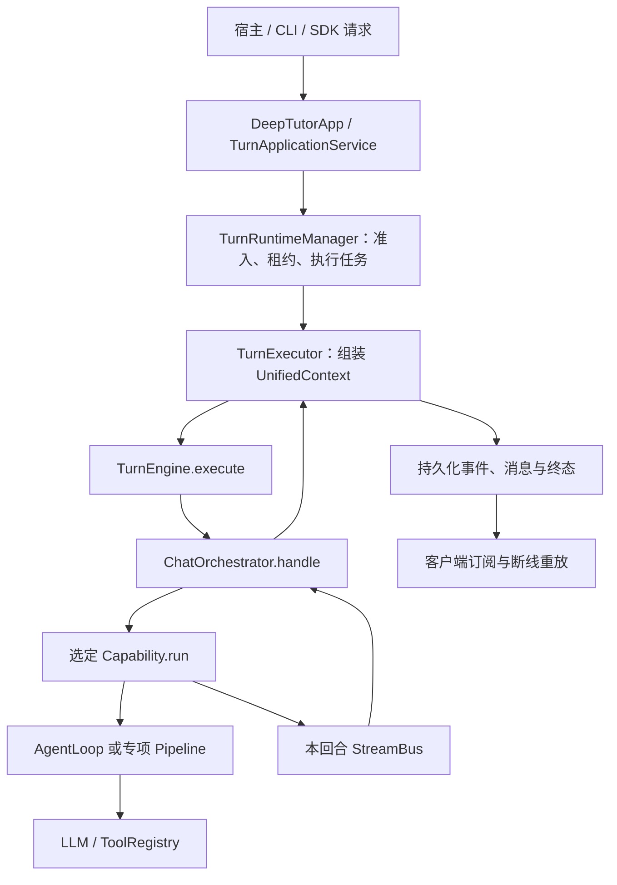

# TurnEngine 与 ChatOrchestrator：一次回合的编排

日期：2026-11-09。直接阅读 D 盘源码、图谱与当前宿主入口；15 个相关源文件与已迁入 vendor 内容一致。本轮未改业务源码。运行 D 盘原版编排/事件流测试，31 项通过（1.10 秒），无真实模型调用。

## 1. 两个类的准确定位

`runtime/turn_engine.py:11` 的 TurnEngine 是低层稳定入口，`execute(context)` 返回异步事件流。它懒加载 ChatOrchestrator，每次 execute 创建新的编排器，并将同一个 UnifiedContext 交给 handle。ApplicationContainer注入同一 capability registry，原生注册表get通常为本回合创建新的capability实例。

`runtime/orchestrator.py:53` 的 ChatOrchestrator选择一个整轮capability、管理本轮StreamBus和后台执行task、记录usage并发布完成通知。它不构建历史、不做模型意图分类、不直接调用LLM、不执行教学策略，也不保存会话。

这是DeepTutor的ChatOrchestrator，和宿主原来的TutorOrchestrator不是同一个实现。

## 2. 完整调用链

模型与工具循环在 capability 里面：普通 chat → ChatCapability → AgenticChatPipeline → AgentLoop；deep_question、deep_research等可使用各自pipeline。ChatOrchestrator选择整轮能力，AgentLoop才决定下一次工具调用，两层职责不同。

## 3. handle(context) 实际执行顺序

1. 如果context没有session_id，生成UUID。正常应用链的session/turn身份通常已由外层准备。
2. 校验PageIndex OSS知识库选择。失败时输出带turn_terminal的ERROR和status=failed的DONE，关闭流并返回。
3. 读取 `context.active_capability or 'chat'`，从注册表取capability。未知能力明确失败，不静默换成别的能力。
4. 输出SESSION事件；为该回合创建StreamBus，存在turn_id时注册到进程内bus表。
5. 创建独立asyncio task运行capability.run(context,bus)，以ContextVar挂接TurnUsage。消费者同时从bus.subscribe读取事件并向外yield。
6. 正常执行完发送DONE；捕获普通Exception时记录日志、发送ERROR，并在DONE标记failed，保留已声明error_code/retryable/partial_response。finally重置usage、关闭bus、注销turn_id。
7. handle消费端被取消或提前关闭时，finally取消尚未结束的capability task并等待其清理，避免模型继续运行或ask_user遗留等待。
8. 正常消费收尾后，向全局EventBus发布CAPABILITY_COMPLETE。只转发显式capability_output/event_metadata和保留身份字段，不把context.metadata整包发布。

`capability.run`的返回值不作为统一回答返回；结果通过CONTENT/RESULT/SOURCES等事件以及context.capability_output交接。

## 4. capability自动选择在哪里

ChatOrchestrator不是“读懂用户并在11个能力中自动推理选择”的模型路由器；这里是根据已确定的active_capability分派。

能力别名解析在DeepTutorApp，自动路由设置/请求覆盖和准入在TurnRequestPreparer等上游层。当前宿主桥接固定auto_route=False，因此真实模式主要按页面/请求指定的capability运行。以后若使用上游自动路由，应接其原生配置，不能把该逻辑另写进ChatOrchestrator。

## 5. 正常结束、失败、等待与取消

| 情况 | 原生处理 |
| --- | --- |
| 正常回答 | capability发内容/结果；内部流DONE；外层保存消息、事件与终态后发布最终DONE |
| 未知能力或PageIndex校验失败 | ERROR + failed DONE，不启动替代能力 |
| capability抛异常 | 内部捕获并输出带终态标记的ERROR，外层结合错误事件确定持久failed状态 |
| ask_user | runtime的wait_for_user_reply把running改waiting_input；用户回复送入同一turn的reply_queue，回到running继续 |
| mastery_quiz | 属于原生教学协议：出题结束当前turn，答案进入下一turn；不能套成ask_user的同轮等待 |
| 明确取消turn | 应用/运行时取消执行task，等待finally收尾，由外层提交cancelled状态 |
| 客户端断线 | 应用层订阅可断开再按seq恢复；不是把后台回合自动取消 |

直接消费ChatOrchestrator生成器时，关闭它会取消其能力task；持久应用链里该生成器的消费者是后台TurnExecutor。浏览器关闭的是外层订阅，两者不能混淆。

## 6. 三种事件通道与完成含义

- **内层StreamBus**：能力把stage、content、tool_call/tool_result、sources/result/error等事件交给编排器；是当前task的内存流。默认不负责正式seq和数据库回放。
- **外层回合事件日志/订阅**：TurnExecutor、TurnLifecycle和coordinator绑定session_id/turn_id、分配或接受canonical seq、持久化并对客户端重放。
- **全局EventBus**：CAPABILITY_COMPLETE通知监听者；是能力执行收尾通知，不能作为数据库提交或宿主正式发布的凭据。

TurnExecutor会暂存内层DONE，先汇总合法答案片段、保存assistant消息、关联turn、flush非终态事件并完成终态转换，再对外发布DONE和消息ID。内部工具/能力收尾与最终公开结果是不同阶段。

CAPABILITY_COMPLETE也不是成功证明：capability异常可被内部转换成事件后正常走到此通知；还要检查错误/持久终态。宿主当前另有正式引用和出题完整性发布检查，原生completed不代表这些业务检查必然通过。

## 7. 我们当前是否已复用

当前真实链路是：main._run_turn → NativeTurnExecutor → NativeTurnBridge → DeepTutorApp.start_turn → TurnApplicationService → TurnRuntimeManager/TurnExecutor → 原版TurnEngine → 原版ChatOrchestrator → 原生capability。

ApplicationContainer创建`TurnEngine(self.capability_registry)`并向runtime registry注入；原生TurnExecutor实际调用`self.turn_engine.execute(context)`。D盘与vendor中的这两个类及13个关联文件完全一致。

因此应保留这套已接入的原生实现。尚需退出的是外层自研协调器的强制初始化、重复上下文、教学覆盖和旧练习入口；不应再写新的TurnEngine或把旧TutorOrchestrator逻辑塞进原生ChatOrchestrator。

## 8. 相关文件及核验范围

核心：runtime/turn_engine.py、runtime/orchestrator.py、runtime/stream_bus.py；契约：core/context.py、core/stream.py、core/capability_protocol.py；注册：runtime/registry/capability_registry.py、runtime/bootstrap/builtin_capabilities.py；应用与持久化：app/facade.py、app/service.py、app/container.py、services/session/turn_runtime.py、services/session/turns/{request_preparer,context_assembler,executor,lifecycle}.py及会话存储/coordinator。

本轮运行tests/runtime/test_orchestrator.py和tests/core/test_stream_bus.py，31项通过，覆盖路由、错误、消费者取消/提前关闭、session_id、完成字段、事件广播与历史等。首次运行受系统临时目录权限影响，改用工作区全新临时目录后通过，没有修改测试或生产代码。未调用真实模型，也未重跑整套持久化/多进程恢复验收。
