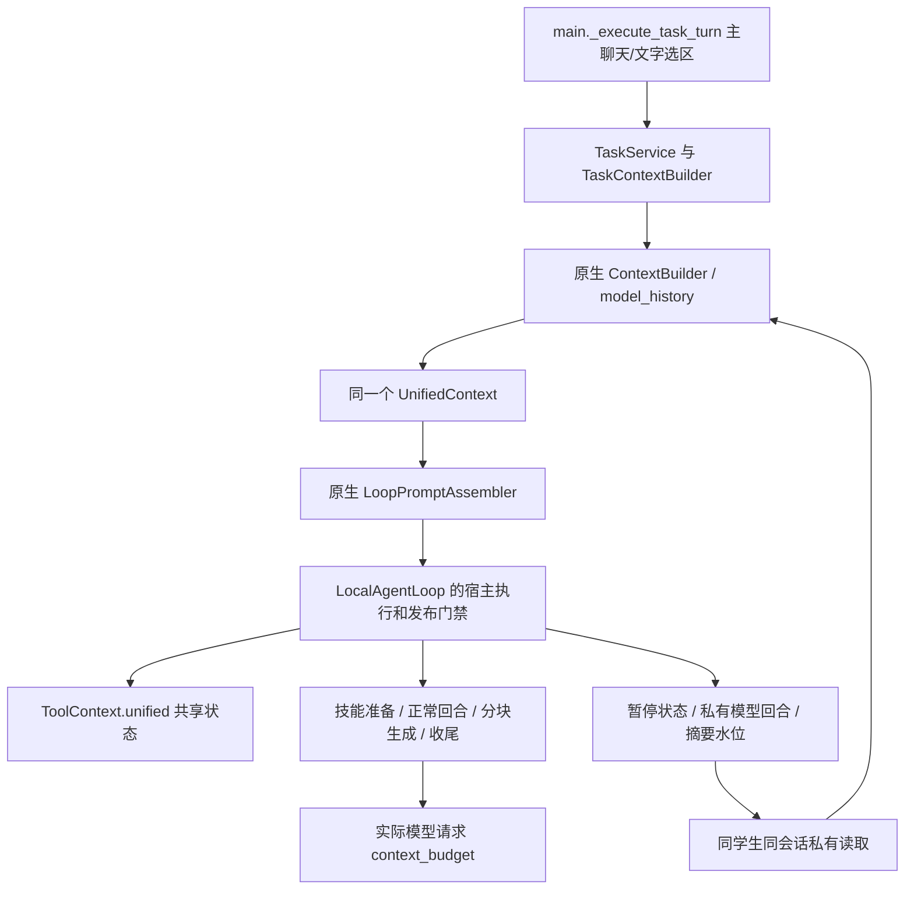

> 2026-11-08 复核补充：本文记录的是选定上下文子集的迁入与验证，不代表第一部分原生上下文行为已全部替换。完整缺口和后续范围见 [第一部分复核](../2026-11-08-deeptutor-complete-runtime/PHASE1_AUDIT.md) 与 [第二部分方案](../2026-11-08-deeptutor-complete-runtime/PHASE2_MIGRATION_PLAN.md)。

# UnifiedContext 关联文件与实际接入清单

本清单来自 D:/deeptutor/.ua/knowledge-graph.json、根目录 ARCHITECTURE.html 和源码构造点。图谱提交为 6cf793bd868ba5ecbe64722936d4be8fab5a01df。

图谱直接关联 37 个文件；全量源码中 61 个文件引用 UnifiedContext。图谱只分析 core/runtime/capabilities，因此额外沿 services/session 和 agents/loop 补全上下文基础设施。

## 本次实际替换与保留

迁入 10 个上游模块，直接替换宿主原来的简化历史和提示词实现。context_window.py 与 prompt_language.py 运行逻辑已相同，保留已有移植。LLM 调用、会话存储、任务身份和取消/发布门禁继续接宿主，不启动第二套应用、不修改 vendor 固定快照。

| 上游模块 | 宿主实际消费者 |
| --- | --- |
| core/context.py | TaskContext 私有回合对象 → LoopRequest → ToolContext.unified → LoopResult |
| services/session/context_builder.py | TaskContextBuilder 和 ResponseGenerator 经 conversation_context.build_history 调用完整 ContextBuilder |
| services/session/model_history.py | 历史分组、工具协议校验与重放、模型回合私有保存 |
| services/session/ask_user_trace.py | ContextBuilder 恢复已回答问题卡的对话顺序 |
| services/session/provider_response_state.py | ContextBuilder 与模型历史的 provider 状态校验 |
| capabilities/protocol.py | 全部宿主 PromptBlock；上下文提示词组装 |
| agents/loop/prompt_blocks.py | 宿主 render_blocks 和 render_turn_prompt；读取技能、来源、记忆、选区与运行信息 |
| agents/loop/context_budget.py | 普通模型回合、技能读取、强制收尾和分块生成的实际请求用量统计 |
| core/stream.py、core/trace.py | 原生 ContextBuilder 的摘要阶段事件和 trace |
| services/llm/context_window.py | 保留 agents/context_window.py；历史预算和用量统计共用 |
| services/prompt/language.py | 保留 agents/prompt_language.py；统一语言契约 |

## 实际主链路

当前本机 LOCAL_AGENT_LOOP_ENABLED 和 SELECTED_TEXT_AGENT_LOOP_ENABLED 均为 1。没有增加新的迁移开关；已有主聊天与文字选区入口直接使用新实现。

## 具体能力消费者的边界

图谱入边还包括 Obsidian、IMA、MarginNote、伙伴、setup、deep_solve 等具体产品能力。它们是 UnifiedContext 的消费者，不是构造这个上下文的必要依赖。完整源码原已在 vendor，本次保留，不重复复制，也不为迁移上下文而自动开放外部工具或新业务入口。下面如标记“保留原生消费者”，不代表宿主已默认启用该专用能力；本次新迁入的 10 个上下文模块全部由上面的实际链路消费。

## 逐文件清单

| 文件 | 图谱直接关联 | 源码引用 | D 盘与 vendor 一致 | 处理 |
| --- | --- | --- | --- | --- |
| deeptutor/agents/_shared/tool_composition.py |  | 是 | 是 | 保留 vendor 的原生消费者；沿用现有原生能力入口 |
| deeptutor/agents/_shared/tool_runtime.py |  | 是 | 是 | 保留 vendor 的原生消费者；沿用现有原生能力入口 |
| deeptutor/agents/_shared/workspace_prompt.py |  | 是 | 是 | 保留 vendor 的原生消费者；沿用现有原生能力入口 |
| deeptutor/agents/chat/capability.py |  | 是 | 是 | 保留 vendor 的原生消费者；沿用现有原生能力入口 |
| deeptutor/agents/loop/agent_loop.py |  | 是 | 是 | 保留 vendor 的原生消费者；沿用现有原生能力入口 |
| deeptutor/agents/loop/context_budget.py |  |  | 是 | 迁入宿主：agents/context_runtime/context_budget.py |
| deeptutor/agents/loop/pipeline.py |  | 是 | 是 | 保留 vendor 的原生消费者；沿用现有原生能力入口 |
| deeptutor/agents/loop/prompt_blocks.py |  | 是 | 是 | 迁入宿主：agents/context_runtime/prompt_blocks.py |
| deeptutor/agents/math_animator/capability.py |  | 是 | 是 | 保留 vendor 的原生消费者；沿用现有原生能力入口 |
| deeptutor/agents/question/capability.py |  | 是 | 是 | 保留 vendor 的原生消费者；沿用现有原生能力入口 |
| deeptutor/agents/question/coordinator.py |  | 是 | 是 | 保留 vendor 的原生消费者；沿用现有原生能力入口 |
| deeptutor/agents/question/pipeline.py |  | 是 | 是 | 保留 vendor 的原生消费者；沿用现有原生能力入口 |
| deeptutor/agents/research/capability.py |  | 是 | 是 | 保留 vendor 的原生消费者；沿用现有原生能力入口 |
| deeptutor/agents/research/pipeline.py |  | 是 | 是 | 保留 vendor 的原生消费者；沿用现有原生能力入口 |
| deeptutor/agents/visualize/capability.py |  | 是 | 是 | 保留 vendor 的原生消费者；沿用现有原生能力入口 |
| deeptutor/book/agents/source_explorer.py |  | 是 | 是 | 保留 vendor 的原生消费者；沿用现有原生能力入口 |
| deeptutor/book/blocks/quiz.py |  | 是 | 是 | 保留 vendor 的原生消费者；沿用现有原生能力入口 |
| deeptutor/capabilities/ask_questions/capability.py | 是 | 是 | 是 | 保留 vendor 的原生消费者；沿用现有原生能力入口 |
| deeptutor/capabilities/ask_questions/loop.py | 是 | 是 | 是 | 保留 vendor 的原生消费者；沿用现有原生能力入口 |
| deeptutor/capabilities/audio_overview/capability.py | 是 | 是 | 是 | 保留 vendor 的原生消费者；沿用现有原生能力入口 |
| deeptutor/capabilities/course_study/capability.py | 是 | 是 | 是 | 保留 vendor 的原生消费者；沿用现有原生能力入口 |
| deeptutor/capabilities/course_study/mode.py | 是 | 是 | 是 | 保留 vendor 的原生消费者；沿用现有原生能力入口 |
| deeptutor/capabilities/explore_context/capability.py | 是 | 是 | 是 | 保留 vendor 的原生消费者；沿用现有原生能力入口 |
| deeptutor/capabilities/explore_context/explorer.py | 是 | 是 | 是 | 保留 vendor 的原生消费者；沿用现有原生能力入口 |
| deeptutor/capabilities/ima/binding.py | 是 | 是 | 是 | 保留 vendor 的原生消费者；沿用现有原生能力入口 |
| deeptutor/capabilities/ima/capability.py | 是 | 是 | 是 | 保留 vendor 的原生消费者；沿用现有原生能力入口 |
| deeptutor/capabilities/marginnote4/binding.py | 是 | 是 | 是 | 保留 vendor 的原生消费者；沿用现有原生能力入口 |
| deeptutor/capabilities/marginnote4/capability.py | 是 | 是 | 是 | 保留 vendor 的原生消费者；沿用现有原生能力入口 |
| deeptutor/capabilities/mastery/capability.py | 是 | 是 | 是 | 保留 vendor 的原生消费者；沿用现有原生能力入口 |
| deeptutor/capabilities/mastery/loop.py | 是 | 是 | 是 | 保留 vendor 的原生消费者；沿用现有原生能力入口 |
| deeptutor/capabilities/mastery/pipeline.py | 是 | 是 | 是 | 保留 vendor 的原生消费者；沿用现有原生能力入口 |
| deeptutor/capabilities/obsidian/binding.py | 是 | 是 | 是 | 保留 vendor 的原生消费者；沿用现有原生能力入口 |
| deeptutor/capabilities/obsidian/capability.py | 是 | 是 | 是 | 保留 vendor 的原生消费者；沿用现有原生能力入口 |
| deeptutor/capabilities/partner_authoring/binding.py | 是 | 是 | 是 | 保留 vendor 的原生消费者；沿用现有原生能力入口 |
| deeptutor/capabilities/partner_authoring/capability.py | 是 | 是 | 是 | 保留 vendor 的原生消费者；沿用现有原生能力入口 |
| deeptutor/capabilities/partner_authoring/tools.py | 是 | 是 | 是 | 保留 vendor 的原生消费者；沿用现有原生能力入口 |
| deeptutor/capabilities/partner_group/capability.py | 是 | 是 | 是 | 保留 vendor 的原生消费者；沿用现有原生能力入口 |
| deeptutor/capabilities/partner_group/tools.py | 是 | 是 | 是 | 保留 vendor 的原生消费者；沿用现有原生能力入口 |
| deeptutor/capabilities/protocol.py | 是 | 是 | 是 | 迁入宿主：agents/context_runtime/protocol.py |
| deeptutor/capabilities/reading/capability.py | 是 | 是 | 是 | 保留 vendor 的原生消费者；沿用现有原生能力入口 |
| deeptutor/capabilities/reading/mode.py | 是 | 是 | 是 | 保留 vendor 的原生消费者；沿用现有原生能力入口 |
| deeptutor/capabilities/registry.py | 是 | 是 | 是 | 保留 vendor 的原生消费者；沿用现有原生能力入口 |
| deeptutor/capabilities/setup/binding.py | 是 | 是 | 是 | 保留 vendor 的原生消费者；沿用现有原生能力入口 |
| deeptutor/capabilities/setup/capability.py | 是 | 是 | 是 | 保留 vendor 的原生消费者；沿用现有原生能力入口 |
| deeptutor/capabilities/solve/capability.py | 是 | 是 | 是 | 保留 vendor 的原生消费者；沿用现有原生能力入口 |
| deeptutor/capabilities/solve/loop.py | 是 | 是 | 是 | 保留 vendor 的原生消费者；沿用现有原生能力入口 |
| deeptutor/capabilities/subagent/binding.py | 是 | 是 | 是 | 保留 vendor 的原生消费者；沿用现有原生能力入口 |
| deeptutor/capabilities/subagent/capability.py | 是 | 是 | 是 | 保留 vendor 的原生消费者；沿用现有原生能力入口 |
| deeptutor/core/__init__.py | 是 | 是 | 是 | 保留 vendor 的原生消费者；沿用现有原生能力入口 |
| deeptutor/core/capability_protocol.py | 是 | 是 | 是 | 保留 vendor 的原生消费者；沿用现有原生能力入口 |
| deeptutor/core/context.py | 是 | 是 | 是 | 迁入宿主：agents/context_runtime/context.py |
| deeptutor/core/stream.py |  |  | 是 | 迁入宿主：agents/context_runtime/stream.py |
| deeptutor/core/trace.py |  |  | 是 | 迁入宿主：agents/context_runtime/trace.py |
| deeptutor/plugins/runtime.py |  | 是 | 是 | 保留 vendor 的原生消费者；沿用现有原生能力入口 |
| deeptutor/runtime/agentic/tool_dispatch.py | 是 | 是 | 是 | 保留 vendor 的原生消费者；沿用现有原生能力入口 |
| deeptutor/runtime/orchestrator.py | 是 | 是 | 是 | 保留 vendor 的原生消费者；沿用现有原生能力入口 |
| deeptutor/runtime/turn_engine.py | 是 | 是 | 是 | 保留 vendor 的原生消费者；沿用现有原生能力入口 |
| deeptutor/services/cron/executor.py |  | 是 | 是 | 保留 vendor 的原生消费者；沿用现有原生能力入口 |
| deeptutor/services/llm/multimodal.py |  | 是 | 是 | 保留 vendor 的原生消费者；沿用现有原生能力入口 |
| deeptutor/services/partners/runtime.py |  | 是 | 是 | 保留 vendor 的原生消费者；沿用现有原生能力入口 |
| deeptutor/services/rag/pipelines/pageindex/reasoning.py |  | 是 | 是 | 保留 vendor 的原生消费者；沿用现有原生能力入口 |
| deeptutor/services/session/ask_user_trace.py |  |  | 是 | 迁入宿主：agents/context_runtime/ask_user_trace.py |
| deeptutor/services/session/context_builder.py |  |  | 是 | 迁入宿主：agents/context_runtime/context_builder.py |
| deeptutor/services/session/model_history.py |  |  | 是 | 迁入宿主：agents/context_runtime/model_history.py |
| deeptutor/services/session/provider_response_state.py |  |  | 是 | 迁入宿主：agents/context_runtime/provider_response_state.py |
| deeptutor/services/session/turns/executor.py |  | 是 | 是 | 保留 vendor 的原生消费者；沿用现有原生能力入口 |
| deeptutor/visualizers/loop_capability.py |  | 是 | 是 | 保留 vendor 的原生消费者；沿用现有原生能力入口 |
| deeptutor/visualizers/tool.py |  | 是 | 是 | 保留 vendor 的原生消费者；沿用现有原生能力入口 |

## 数据边界

- 只保存经过工具协议校验和私有答案参数脱敏的当前模型回合，避免下一轮重复携带全部历史。
- 模型回合和摘要水位放在已有引用记录的私有字段；公开会话、学习事件与记忆索引不返回这些字段。
- 遗忘知识点、遗忘偏好或更正误区后，清除该学生的旧模型快照和摘要，避免缓存复活失效信息。
- 摘要失败不推进水位、不覆盖原始对话；最新完整回合保留。长历史可能增加一次宿主模型摘要调用。
- 未修改实际 .env、正式学生数据或运行中的服务；需由新进程加载更新后的代码。
